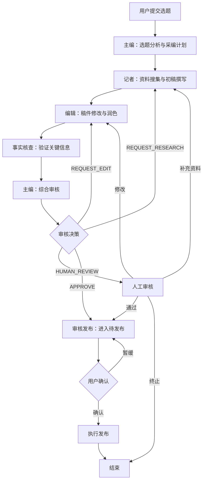

# AI Newsroom 智能新闻编辑部 — 产品需求规格说明书（PRD）

| 项目 | 内容 |
| --- | --- |
| 文档编号 | NR-PRD-001 |
| 文档版本 | V0.1 |
| 项目名称 | AI Newsroom |
| 项目类型 | 多智能体协作新闻采编系统 |
| 日期 | 2026-11-13 |
| 状态 | 基线文档 |
| 关联文档 | [系统架构](../02-architecture/system-architecture.md)、[Agent 设计](../03-agent-design/agent-specification.md)、[工作流](../04-workflow/workflow-design.md) |

---

## 1. 项目概述

### 1.1 项目背景

随着大语言模型和人工智能技术的发展，新闻行业逐渐出现利用人工智能辅助新闻资料搜集、内容生成、稿件编辑和事实核查的应用场景。

传统新闻采编工作通常需要记者、编辑、审核人员等多个角色协同完成，涉及选题策划、信息搜集、新闻撰写、稿件修改和内容审核等多个环节。整个过程存在任务分配复杂、资料整理耗时、信息核查工作量大等问题。

本项目拟设计并实现一个基于多智能体协作技术的智能新闻编辑部系统，将传统新闻编辑部的工作模式抽象为多个具有独立职责的 AI Agent，通过工作流编排实现不同 Agent 之间的协同工作。

### 1.2 项目目标

构建一个具备基本新闻采编能力的多智能体系统。

用户只需要提交新闻选题及相关要求，系统即可自动完成选题分析、采编计划生成、新闻资料搜集、新闻初稿撰写、稿件编辑、事实核查和审核决策等工作。

系统最终生成经过编辑和事实核查的新闻稿件，并交由用户确认是否发布。

### 1.3 目标用户

| 用户 | 说明 |
| --- | --- |
| 新闻编辑及新闻工作者 | 使用系统辅助完成日常新闻采编工作 |
| 内容创作者 | 利用系统进行新闻资料搜集和内容整理 |
| 系统管理员 | 管理系统运行状态、用户任务和相关配置 |

> 课程设计阶段以**普通用户**和**系统管理员**两类角色为主要实现对象。

---

## 2. 系统功能需求

### 2.1 新闻选题管理

用户可以创建新闻采编任务，提交新闻选题及相关要求。

主要功能：

- 创建新闻采编任务。
- 输入新闻选题和背景描述。
- 指定新闻报道方向。
- 设置目标文章篇幅。
- 设置新闻风格。
- 查看历史采编任务。
- 查询任务执行状态。

### 2.2 主编 Agent 功能

主编 Agent 是整个系统的任务规划与协调中心。

主要功能：

- 分析用户提交的新闻选题。
- 确定新闻报道角度。
- 制定资料搜集计划。
- 生成新闻文章结构建议。
- 明确需要重点核实的信息。
- 将任务分配给记者 Agent。
- 跟踪各 Agent 的执行状态。
- 根据事实核查报告作出流程决策。
- 审核最终新闻稿件。
- 决定稿件通过、退回修改、补充资料或转人工审核。

> 主编 Agent 不直接承担记者 Agent 的资料搜索和新闻初稿撰写任务。

### 2.3 记者 Agent 功能

记者 Agent 负责根据采编计划完成新闻资料搜集和新闻初稿撰写。

主要功能：

- 接收主编 Agent 下发的采编任务。
- 根据任务要求生成搜索关键词。
- 调用互联网搜索工具获取资料。
- 整理新闻事件相关信息。
- 提取重要事实及信息来源。
- 根据采编计划撰写新闻初稿。
- 根据主编的要求补充资料或重新撰写。

> 记者 Agent 输出内容必须包含新闻初稿及其参考资料，不能只返回一段没有来源说明的新闻文本。

### 2.4 编辑 Agent 功能

编辑 Agent 负责对记者提交的新闻初稿进行编辑和优化。

主要功能：

- 检查文章结构是否完整。
- 调整新闻标题和段落结构。
- 优化语言表达。
- 检查上下文逻辑。
- 统一新闻写作风格。
- 根据主编意见修改稿件。
- 保留原始稿件和编辑后稿件的版本信息。

> 编辑 Agent 不应擅自修改未经证实的新闻事实。

### 2.5 事实核查 Agent 功能

事实核查 Agent 负责检查新闻稿件中的关键信息是否具有可靠依据。

主要功能：

- 提取稿件中的关键事实声明。
- 核实人物、时间、地点及事件信息。
- 检查新闻数据和统计信息。
- 检查引用内容及其来源。
- 通过互联网搜索获取佐证资料。
- 对不同来源的信息进行交叉验证。
- 标记无法核实或存在矛盾的信息。
- 生成结构化事实核查报告。

核查结果包括**通过、部分通过和不通过**三种状态。事实核查 Agent 不负责决定稿件是否正式发布。

### 2.6 审核发布 Agent 功能

审核发布 Agent 负责管理新闻稿件的最终发布流程。

主要功能：

- 接收主编 Agent 的审核通过结果。
- 检查稿件是否满足发布前置条件。
- 将稿件设置为待发布状态。
- 等待用户确认。
- 用户确认后调用发布接口。
- 记录发布时间和发布结果。
- 发布失败时保留稿件并记录错误信息。

> 审核发布 Agent 不拥有独立决定新闻内容是否合格的权限。

### 2.7 新闻稿件管理

系统提供统一的稿件管理功能：

- 查看新闻初稿。
- 查看编辑后的稿件。
- 查看事实核查报告。
- 查看主编审核意见。
- 查看稿件修改历史。
- 查看稿件当前状态。
- 保存最终稿件。

### 2.8 任务状态管理

系统展示新闻采编任务的整体执行进度。

| 状态 | 说明 |
| --- | --- |
| `CREATED` | 任务已创建 |
| `PLANNING` | 正在进行选题分析 |
| `RESEARCHING` | 正在搜集资料 |
| `WRITING` | 正在撰写新闻初稿 |
| `EDITING` | 正在编辑稿件 |
| `FACT_CHECKING` | 正在进行事实核查 |
| `REVIEWING` | 正在进行主编审核 |
| `HUMAN_REVIEW` | 等待人工审核（工作流转人工时） |
| `PENDING_PUBLISH` | 等待用户确认发布 |
| `PUBLISHED` | 已经发布 |
| `REVISION_REQUIRED` | 需要修改（退回编辑或补充资料） |
| `FAILED` | 任务执行失败 |
| `CANCELLED` | 任务已取消 |

> `HUMAN_REVIEW`、`REVISION_REQUIRED` 为流程内部状态，二者与主编决策 `REQUEST_EDIT` / `REQUEST_RESEARCH` / `HUMAN_REVIEW` 对应。

---

## 3. 核心业务流程

用户提交新闻选题后，系统首先调用主编 Agent 生成采编计划，并将任务分配给记者 Agent。

记者 Agent 完成资料搜集和新闻初稿撰写后，将结果提交给编辑 Agent。编辑 Agent 完成稿件修改后，再将稿件提交给事实核查 Agent。

事实核查 Agent 根据新闻内容和资料来源生成核查报告，并将结果反馈给主编 Agent。主编 Agent 根据核查结果和原始采编计划进行综合审核。

- 如果稿件存在事实问题，则退回记者 Agent 补充资料；
- 如果存在表达或结构问题，则退回编辑 Agent 修改；
- 如果存在争议或重要信息无法确定，则转人工审核；
- 审核通过后，稿件进入待发布状态，用户确认后调用发布接口完成发布。

---

## 4. 非功能需求

### 4.1 可维护性

各 Agent 采用模块化设计，能够独立开发、测试和维护。

### 4.2 可扩展性

系统支持后续增加新的 Agent、搜索工具及新闻发布渠道。

### 4.3 稳定性

系统支持模型调用失败、外部接口异常和 Agent 执行失败等情况的异常处理。

### 4.4 可追溯性

系统保存任务执行日志、稿件版本、信息来源及审核结果。

### 4.5 安全性

- 保护用户数据和 API 密钥；
- 限制发布操作权限；
- 防止未经确认的稿件自动发布；
- 外部网页内容视为不可信输入，防止 Prompt 注入。

---

## 5. 项目范围

### 5.1 第一阶段实现范围

- 新闻选题创建。
- 主编 Agent 选题分析与任务规划。
- 记者 Agent 资料搜索和初稿撰写。
- 编辑 Agent 稿件优化。
- 事实核查 Agent 基础核查。
- 主编 Agent 审核决策。
- 审核发布 Agent 待发布管理。
- LangGraph 工作流控制。
- 任务状态和稿件管理。

### 5.2 暂不实现的功能

- 多用户实时协同编辑。
- 复杂的新闻图片及视频生成。
- 自动运营多个新闻媒体账号。
- 完整的新闻舆情分析。
- 复杂的商业化权限体系。

---

## 6. 验收标准

系统至少应满足以下条件：

1. 用户能够成功创建新闻采编任务。
2. 主编 Agent 能够生成结构化采编计划。
3. 记者 Agent 能够调用搜索工具并生成带来源的新闻初稿。
4. 编辑 Agent 能够根据初稿生成优化后的稿件。
5. 事实核查 Agent 能够输出包含核查结果和证据来源的报告。
6. 主编 Agent 能够根据核查结果执行不同的工作流决策。
7. 系统能够正确处理退回修改和补充资料流程。
8. 审核发布 Agent 能够管理待发布状态。
9. 未经用户确认，系统不得执行正式发布。
10. 系统能够查询新闻任务的执行状态和历史结果。
