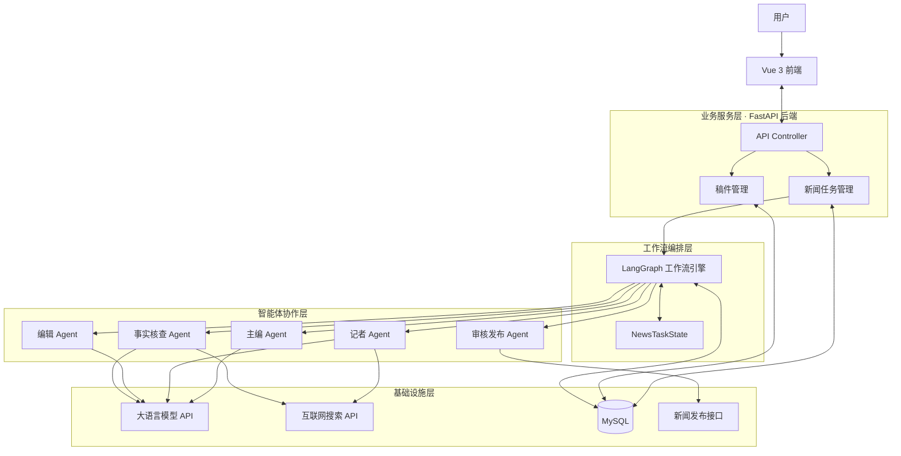
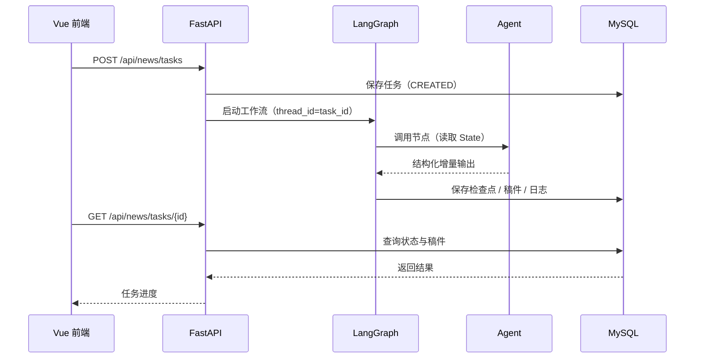
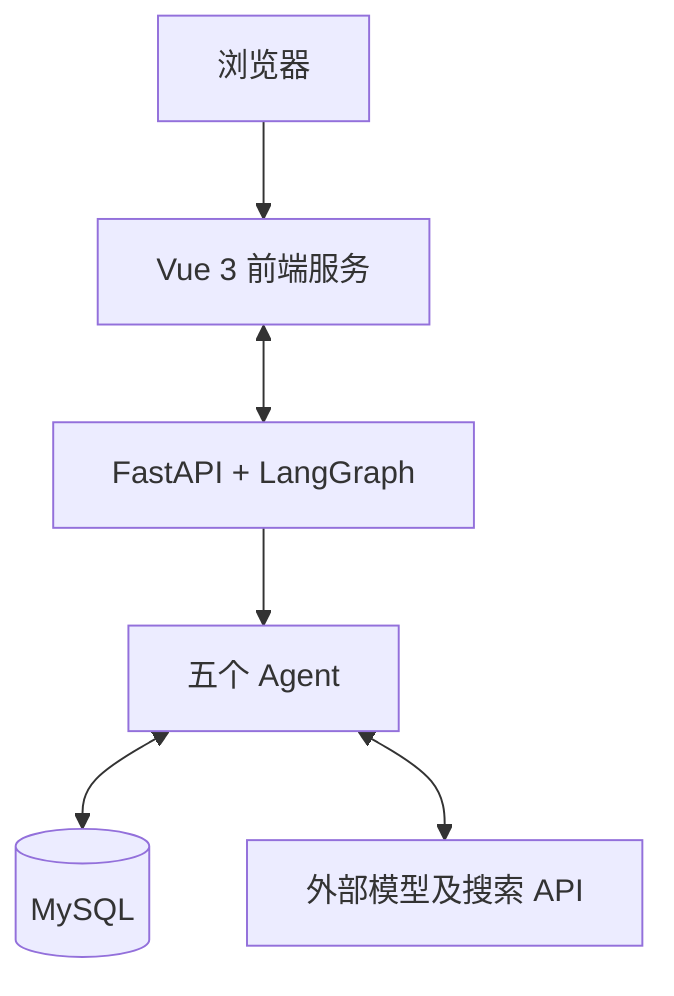

# AI Newsroom 智能新闻编辑部 — 系统总体架构设计文档（HLD）

| 项目 | 内容 |
| --- | --- |
| 文档编号 | NR-HLD-001 |
| 文档版本 | V0.1 |
| 日期 | 2026-11-13 |
| 状态 | 基线文档 |
| 关联文档 | [PRD](../01-requirements/PRD.md)、[Agent 设计](../03-agent-design/agent-specification.md)、[工作流设计](../04-workflow/workflow-design.md)、[状态设计](../05-data-design/state-schema.md) |

---

## 1. 架构设计目标

本系统采用**分层架构 + 多智能体协作**的设计方式，以 LangGraph 作为核心工作流编排框架，实现新闻采编任务的自动化执行和智能决策。

| 目标 | 说明 |
| --- | --- |
| 模块化 | 将不同业务功能划分为相对独立的模块 |
| 可扩展 | 支持增加 Agent、工具及外部服务 |
| 可追踪 | 能够追踪任务状态和 Agent 执行记录 |
| 可恢复 | 能够处理工作流异常和任务中断 |
| 可控性 | 关键业务决策和正式发布操作保留必要的人工确认 |

---

## 2. 系统总体架构

系统采用**五层架构**：

1. **表现层**：负责用户交互和新闻任务管理。
2. **业务服务层**：负责新闻任务管理、稿件管理、用户操作和业务接口。
3. **智能体协作层**：由五个 Agent 组成，分别承担新闻采编过程中的不同职责。
4. **工作流编排层**：采用 LangGraph 管理 Agent 执行顺序、共享状态和条件路由。
5. **基础设施层**：提供大语言模型、搜索工具、数据库和外部发布接口。



---

## 3. 核心模块设计

### 3.1 前端模块（表现层）

采用 Vue 3 实现用户界面，主要包括：

- 新闻任务创建页面。
- 新闻任务列表页面。
- 新闻采编进度页面。
- 新闻稿件查看与编辑页面。
- 事实核查报告页面。
- 最终审核及发布确认页面。

### 3.2 后端服务模块（业务服务层）

采用 FastAPI 提供 RESTful API，主要负责：

- 接收用户提交的任务。
- 创建和管理新闻任务。
- 调用 LangGraph 工作流。
- 查询工作流执行状态。
- 保存稿件及核查报告。
- 接收用户审核和发布操作。

> 后端服务负责业务接口和数据访问，**不直接承担 Agent 内部的复杂任务规划逻辑**。

### 3.3 Agent 模块（智能体协作层）

五个 Agent 作为独立业务组件实现。

- 每个 Agent 包含独立的提示词、模型调用逻辑、工具配置和输出结构。
- Agent 不直接操作前端。
- Agent 不绕过统一的工作流状态管理机制修改其他 Agent 的业务结果。
- Agent 之间不直接互调，统一通过 `NewsTaskState` 交换信息。

### 3.4 工作流编排模块

采用 LangGraph 构建新闻采编工作流，负责：

- Agent 节点注册。
- 节点执行顺序管理。
- 条件路由。
- 状态传递。
- 循环和退回。
- 执行中断和恢复。
- 人工审核等待。

### 3.5 数据存储模块

采用 MySQL 保存业务数据，主要包括用户信息、新闻任务、采编计划、资料来源、稿件版本、核查报告、审核记录、执行日志和发布记录。

> FAISS 暂时不作为核心依赖，只有在后续需要对大量新闻资料进行语义检索时再引入。

---

## 4. 技术选型

| 技术 | 选型 | 说明 |
| --- | --- | --- |
| 开发语言 | Python | Agent 和后端开发 |
| Agent 工作流 | LangGraph | 多 Agent 调度 |
| LLM 接口 | OpenAI 兼容 API | 模型调用 |
| 后端 | FastAPI | 业务接口 |
| 前端 | Vue 3 | 用户界面 |
| 数据库 | MySQL | 业务数据存储 |
| ORM | SQLAlchemy | 数据库访问 |
| 数据校验 | Pydantic | 输入输出结构校验 |
| 搜索服务 | Tavily 或其他搜索 API | 新闻资料检索 |
| 前端请求 | Axios | HTTP 通信 |

---

## 5. 系统内部通信机制

系统采用两种主要通信方式。

### 5.1 HTTP API 通信

用于前端与后端之间的交互。用户通过 API 创建任务、查询稿件和提交审核操作。

### 5.2 工作流状态传递

用于 LangGraph 内部 Agent 之间的信息交互。各 Agent 从统一的 `NewsTaskState` 中读取所需信息，并通过结构化输出更新任务状态。

这种方式可以减少 Agent 之间直接相互调用造成的耦合。



---

## 6. 项目部署方案

课程设计阶段采用**单体部署**方式：将 FastAPI 后端、LangGraph 工作流和各 Agent 集成在同一个 Python 后端项目中，Vue 前端单独运行，MySQL 提供数据存储。



后续如果系统规模扩大，可以将 Agent 执行服务和 API 服务拆分部署。

### 规划目录

```
backend/app/
├── main.py          # FastAPI 入口
├── api/             # 任务、稿件、审核、发布接口
├── services/        # 业务服务
├── agents/          # 五个 Agent
├── graph/           # LangGraph 节点与路由
├── tools/           # 搜索、抓取、来源提取、发布
├── models/          # SQLAlchemy 模型
├── schemas/         # Pydantic 模型
├── prompts/         # Prompt 模板
└── core/            # 配置、日志、LLM 客户端

frontend/src/
├── api/             # Axios 封装
├── views/           # 任务、进度、稿件、核查、发布页面
├── components/      # 通用组件
├── stores/          # Pinia
└── router/
```

---

## 7. 架构约束

1. 所有 Agent 必须遵循统一的数据输入输出规范。
2. 工作流状态由 LangGraph 统一管理。
3. Agent 不得绕过主编的审核决策直接发布稿件。
4. 新闻资料应保留来源链接及必要的元数据。
5. 模型 API 密钥通过环境变量或安全配置管理，不允许硬编码在源代码中。
6. 外部服务调用必须设置超时和异常处理机制。
7. 发布操作必须校验主编审核结果与用户确认状态。

---

## 8. 关键风险与应对

| 风险 | 影响 | 应对 |
| --- | --- | --- |
| LLM 输出不稳定 | 节点解析失败、流程中断 | Pydantic 校验 + 有限重试 + 转人工 |
| 搜索质量不足 | 资料缺失、来源不可靠 | 多关键词重试、来源元数据校验、要求补充资料 |
| 新闻事实幻觉 | 新闻失实 | 强制来源、独立事实核查、主编决策、用户确认 |
| Prompt 注入（网页内容） | Agent 行为被劫持 | 外部内容标记为不可信、输出结构校验 |
| 长流程中断 | 进度丢失 | Checkpointer 持久化 + 恢复接口 |
| 未确认发布 | 合规风险 | 发布节点硬性校验 `user_confirmation` |
