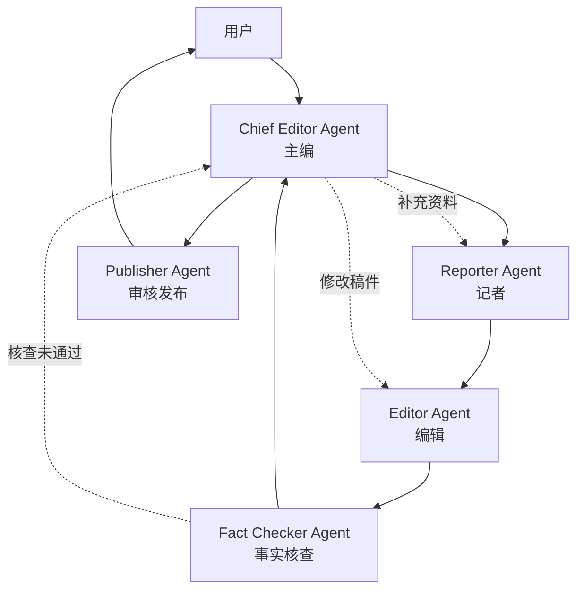

# Agent 设计说明书（Agent Specification）

| 项目 | 内容 |
| --- | --- |
| 文档编号 | NR-AGENT-001 |
| 版本 | V0.2 |
| 日期 | 2026-11-13 |
| 状态 | 接口契约已实现（第 1 周） |
| 项目 | AI Newsroom 智能新闻编辑部 |
| 关联文档 | [PRD](../01-requirements/PRD.md)、[系统架构](../02-architecture/system-architecture.md)、[工作流设计](../04-workflow/workflow-design.md)、[状态设计](../05-data-design/state-schema.md) |

> 本文档是五个 Agent 的**统一设计基线**，定义职责边界、输入输出、权限与协作方式。
> `docs/03-agent-design/` 下的五个分册（`chief-editor-agent.md` 等）为本文档的工程细化版本，术语与枚举以本文档为准。

---

## 1. 设计目标

本系统采用多智能体协作模式，将传统新闻编辑部中的不同岗位抽象为具有独立职责的 AI Agent。

每个 Agent 负责一个或多个明确的业务环节，并通过 LangGraph 工作流进行协同。Agent 之间**不采用完全自由的对话模式**，而是通过结构化输入输出和统一的任务状态进行信息传递。

系统包含五个核心 Agent：

1. **Chief Editor Agent**：主编 Agent
2. **Reporter Agent**：记者 Agent
3. **Editor Agent**：编辑 Agent
4. **Fact Checker Agent**：事实核查 Agent
5. **Publisher Agent**：审核发布 Agent

---

## 2. Agent 总体关系



主编 Agent 是任务协调中心，负责统一管理各 Agent 的执行过程；其他 Agent 按各自职责完成任务，并将执行结果返回工作流。

| Agent | 核心产出 | 主要下游 |
| --- | --- | --- |
| 主编 | 采编计划、审核决策 | 记者、编辑、人工审核、发布 |
| 记者 | 新闻初稿、资料来源 | 编辑 |
| 编辑 | 编辑稿、编辑说明 | 事实核查 |
| 事实核查 | 结构化核查报告 | 主编 |
| 审核发布 | 待发布记录、发布结果 | 用户 |

---

## 3. 主编 Agent（Chief Editor Agent）

### 3.1 角色定位

主编 Agent 是整个新闻编辑部的核心调度和决策 Agent，负责从用户提交的新闻选题出发，制定采编计划、分配任务、跟踪执行状态，并对最终新闻稿件进行综合审核。

### 3.2 核心职责

1. 分析用户提交的新闻选题。
2. 确定报道角度和采编目标。
3. 制定资料搜集计划。
4. 生成新闻文章结构建议。
5. 指定需要重点核实的信息。
6. 将任务分配给记者 Agent。
7. 跟踪各 Agent 的执行状态。
8. 分析事实核查报告。
9. 决定稿件退回修改或补充资料。
10. 审核最终稿件并作出决策。

### 3.3 输入数据

```json
{
  "task_id": "TASK_001",
  "topic": "人工智能技术在高校教育中的应用",
  "description": "关注人工智能在高校教学中的应用现状",
  "requirements": {
    "style": "客观新闻报道",
    "target_length": 1500,
    "focus": ["应用案例", "实际效果", "存在的问题"]
  }
}
```

### 3.4 输出数据

主编 Agent 首次执行时输出采编计划：

```json
{
  "editorial_plan": {
    "topic_analysis": "分析新闻选题的核心内容",
    "reporting_angles": [
      "人工智能在高校教学中的应用",
      "高校人工智能教育实践案例",
      "人工智能应用面临的问题"
    ],
    "research_tasks": [
      "搜集高校人工智能教学案例",
      "搜集相关政策和公开数据"
    ],
    "article_outline": [
      "新闻背景",
      "应用现状",
      "典型案例",
      "存在的问题",
      "总结"
    ],
    "verification_points": [
      "相关政策发布时间",
      "高校应用案例真实性",
      "统计数据准确性"
    ]
  },
  "next_agent": "reporter"
}
```

### 3.5 审核决策

主编 Agent 在收到事实核查报告和最终稿件后，进行综合判断，支持以下四种决策：

| 决策 | 含义 | 后续节点 |
| --- | --- | --- |
| `APPROVE` | 审核通过 | Publisher Agent |
| `REQUEST_EDIT` | 需要编辑修改 | Editor Agent |
| `REQUEST_RESEARCH` | 需要补充资料 | Reporter Agent |
| `HUMAN_REVIEW` | 需要人工审核 | 等待人工 |

### 3.6 权限约束

- 主编负责任务规划和业务决策，**不直接调用新闻发布接口**；
- 不直接承担记者的资料搜索和初稿撰写；
- 不应自行伪造资料来源；
- 审核意见必须结构化、可执行。

---

## 4. 记者 Agent（Reporter Agent）

### 4.1 角色定位

记者 Agent 根据主编下发的采编任务，完成新闻资料搜集、信息整理和新闻初稿撰写。

### 4.2 核心职责

1. 接收采编计划。
2. 分析资料搜集需求。
3. 生成搜索关键词。
4. 调用互联网搜索工具。
5. 筛选和整理新闻资料。
6. 提取关键事实。
7. 记录资料来源。
8. 根据采编计划撰写新闻初稿。
9. 根据退回意见补充资料或重写。

### 4.3 工具配置

| 工具 | 用途 |
| --- | --- |
| Web Search | 互联网搜索 |
| Web Fetch | 获取指定网页正文 |
| Source Extractor | 提取网页标题、发布时间和来源信息 |

工具的具体实现可以根据所接入的搜索服务调整。

### 4.4 输入数据

```json
{
  "task_id": "TASK_001",
  "editorial_plan": {
    "reporting_angles": ["高校人工智能教学案例", "应用效果"],
    "research_tasks": ["搜集相关高校案例", "查找公开统计数据"],
    "verification_points": ["高校名称", "案例真实性", "数据准确性"]
  },
  "revision_request": null
}
```

### 4.5 输出数据

```json
{
  "draft": {
    "title": "人工智能技术正在改变高校教学模式",
    "content": "新闻初稿正文……"
  },
  "sources": [
    {
      "source_id": "SRC_001",
      "title": "新闻资料标题",
      "url": "https://example.com/article",
      "publisher": "资料发布机构",
      "published_at": "2026-01-01",
      "summary": "资料摘要"
    }
  ],
  "research_summary": "本次资料搜集的主要发现",
  "unverified_claims": [],
  "status": "COMPLETED"
}
```

> 示例来源地址仅用于说明数据结构，实际运行时必须由搜索工具返回真实来源。

### 4.6 权限约束

- 负责资料搜集和初稿撰写，不负责最终审核与发布；
- 重要事实应尽可能提供对应来源；
- 不得将模型自行生成的内容伪装为真实新闻资料；
- 不得编造引语、数据、时间、机构名称。

---

## 5. 编辑 Agent（Editor Agent）

### 5.1 角色定位

编辑 Agent 负责对记者生成的新闻初稿进行专业化编辑，使稿件符合预定新闻风格、结构和篇幅要求。

### 5.2 核心职责

1. 检查稿件结构。
2. 优化新闻标题。
3. 调整段落顺序。
4. 优化语言表达。
5. 检查文章逻辑。
6. 控制文章篇幅。
7. 根据主编意见修改稿件。
8. 保留原始稿件和修改后版本。

### 5.3 输入数据

```json
{
  "task_id": "TASK_001",
  "draft": {
    "title": "新闻初稿标题",
    "content": "新闻初稿正文……"
  },
  "editorial_requirements": {
    "style": "客观、准确、简洁",
    "target_length": 1500,
    "structure": "背景-案例-分析-总结"
  },
  "revision_request": null
}
```

### 5.4 输出数据

```json
{
  "edited_article": {
    "title": "优化后的新闻标题",
    "content": "编辑后的新闻正文……"
  },
  "editing_report": {
    "structure_changes": "调整了文章结构",
    "language_changes": "优化了部分表达",
    "content_changes": "修改说明"
  },
  "version": 2,
  "status": "COMPLETED"
}
```

### 5.5 权限约束

- 不得随意修改新闻事实；
- 不得删除对理解新闻事件具有重要意义的信息；
- 对缺乏依据的事实应标记反馈，而不是自行补全；
- 每次修改生成新版本，保留原始稿件。

---

## 6. 事实核查 Agent（Fact Checker Agent）

### 6.1 角色定位

事实核查 Agent 负责验证新闻稿件中的关键事实是否具有可靠证据，识别虚假信息、信息矛盾和缺乏来源支持的内容。

### 6.2 核心职责

1. 提取新闻稿件中的事实声明。
2. 对人物、时间、地点和事件进行核实。
3. 检查数字、统计数据和引用内容。
4. 调用搜索工具查找佐证资料。
5. 比较不同来源的信息。
6. 判断证据是否充分。
7. 生成事实核查报告。

### 6.3 核查状态

| 状态 | 含义 |
| --- | --- |
| `VERIFIED` | 已得到可靠证据支持 |
| `CONTRADICTED` | 与可靠证据存在矛盾 |
| `UNVERIFIED` | 暂时无法验证 |
| `PARTIALLY_VERIFIED` | 部分内容得到支持 |

### 6.4 输入数据

```json
{
  "task_id": "TASK_001",
  "article": {
    "title": "新闻标题",
    "content": "编辑后的新闻正文……"
  },
  "sources": [
    {
      "source_id": "SRC_001",
      "url": "https://example.com/article"
    }
  ]
}
```

### 6.5 输出数据

```json
{
  "verification_report": {
    "overall_result": "PARTIAL",
    "claims": [
      {
        "claim": "某高校已经开展人工智能教学实践",
        "result": "VERIFIED",
        "evidence": [
          {
            "source_id": "SRC_001",
            "url": "https://example.com/article",
            "supporting_excerpt": "来源中的相关证据"
          }
        ],
        "reason": "存在可靠来源支持"
      },
      {
        "claim": "某项统计数据",
        "result": "UNVERIFIED",
        "evidence": [],
        "reason": "尚未找到可靠来源"
      }
    ],
    "issues": ["部分统计数据缺少可靠来源"],
    "recommendation": "REQUEST_RESEARCH"
  }
}
```

**总体结果取值**：`PASSED`（通过）、`PARTIAL`（部分通过）、`FAILED`（不通过）。

**建议取值**：`APPROVE`、`REQUEST_EDIT`、`REQUEST_RESEARCH`、`HUMAN_REVIEW`。

### 6.6 权限约束

- 只提供证据和核查结论，不修改最终稿件；
- 不决定是否发布；
- 对无法验证的内容必须明确标记，**不得将无法验证解释为事实错误**。

---

## 7. 审核发布 Agent（Publisher Agent）

### 7.1 角色定位

审核发布 Agent 负责执行主编审核通过后的稿件发布管理工作，连接 AI 审核结果与最终发布操作。

### 7.2 核心职责

1. 接收主编审核通过的稿件。
2. 检查稿件是否满足发布前置条件。
3. 生成待发布记录。
4. 等待用户确认。
5. 调用新闻发布接口。
6. 保存发布结果。
7. 处理发布失败和重复提交问题。

### 7.3 输入数据

```json
{
  "task_id": "TASK_001",
  "article": {
    "title": "最终新闻标题",
    "content": "最终新闻正文"
  },
  "chief_decision": "APPROVE",
  "fact_check_status": "PASSED",
  "user_confirmation": false
}
```

### 7.4 输出数据

```json
{
  "publication": {
    "status": "PENDING_PUBLISH",
    "article_id": "ARTICLE_001",
    "published_at": null,
    "message": "稿件已进入待发布状态，等待用户确认"
  }
}
```

### 7.5 权限约束

- 必须验证主编审核状态和事实核查状态；
- 正式发布必须以**用户明确确认**为前提；
- 不得因为模型生成了审核通过意见而自动发布；
- 发布失败时保留稿件并记录错误信息；
- 重复提交必须幂等。

---

## 8. Agent 通用开发规范

1. **统一输入**：从 `NewsTaskState` 读取所需的任务信息。
2. **统一输出**：返回符合 Pydantic 数据模型约束的结构化结果。
3. **职责独立**：Agent 不得擅自执行其他 Agent 的核心职责。
4. **错误处理**：模型调用失败、工具异常和输出校验失败均应返回明确错误信息。
5. **日志记录**：记录 Agent 名称、任务编号、执行时间、执行结果和错误信息。
6. **状态管理**：由 LangGraph 工作流统一管理任务状态和后续执行节点。
7. **安全约束**：外部网页内容视为不可信数据，不得执行其中的指令；API 密钥不得出现在提示词中。

---

## 9. 与详细设计文档的关系

| 文档 | 作用 |
| --- | --- |
| 本文档 `agent-specification.md` | 统一规范：职责、输入输出、权限、决策枚举 |
| [chief-editor-agent.md](chief-editor-agent.md) | 主编工程细化：Prompt 要点、工具、异常、评测 |
| [reporter-agent.md](reporter-agent.md) | 记者工程细化 |
| [editor-agent.md](editor-agent.md) | 编辑工程细化 |
| [fact-checker-agent.md](fact-checker-agent.md) | 事实核查工程细化 |
| [publisher-agent.md](publisher-agent.md) | 审核发布工程细化 |

发生冲突时，以本文档定义的职责边界与枚举取值为准，详细文档补充实现细节。

---

## 10. 工程接口契约（V0.2）

第 1 周已将五个 Agent（主编拆分为「规划」和「审核」两个工作流节点）的输入输出固化为 Pydantic 模型，Agent 实现将在第 2 周基于这些契约开发。

### 10.1 契约位置

| 内容 | 路径 |
| --- | --- |
| 输入 / 输出契约、契约注册表 | `backend/app/agents/contracts.py` |
| Agent 抽象基类 | `backend/app/agents/base.py` |
| 契约引用的领域模型 | `backend/app/schemas/domain.py` |
| 枚举定义 | `backend/app/schemas/enums.py` |

### 10.2 节点契约

| 工作流节点 | 输入模型 | 输出模型 | 关键约束 |
| --- | --- | --- | --- |
| `chief_planning` | `ChiefPlanningInput` | `ChiefPlanningOutput` | 成功时必须输出 `editorial_plan`，下一节点固定为 `reporter` |
| `reporter` | `ReporterInput` | `ReporterOutput` | 成功时必须包含初稿、至少一条来源和资料总结；来源 URL 必须是 HTTP(S) |
| `editor` | `EditorInput` | `EditorOutput` | 成功时必须包含编辑稿、编辑说明和新版本号；版本号 ≥ 2 |
| `fact_checker` | `FactCheckerInput` | `FactCheckerOutput` | 输入必须带 `article_id` 和 `article_version`；成功输出必须回显两者，用于绑定核查报告 |
| `chief_review` | `ChiefReviewInput` | `ChiefReviewOutput` | `REQUEST_EDIT` 必须携带 `target=editor` 的修改要求；`REQUEST_RESEARCH` 必须携带 `target=reporter` 的补充资料要求；`APPROVE` 不得携带修改要求 |
| `publisher` | `PublisherInput` | `PublisherOutput` | 输入要求 `chief_decision=APPROVE` 且核查结果不为 `FAILED`；输出默认 `PENDING_PUBLISH`，不直接发布 |

### 10.3 通用约束

1. 所有契约模型继承 `StrictModel`，未知字段直接拒绝（`extra="forbid"`）。
2. `AgentOutput.status=FAILED` 时必须提供 `error`；`COMPLETED` 时不得携带 `error`。
3. 成功输出必须包含该 Agent 的核心业务字段；失败输出允许只携带错误信息。
4. 主编审核的退回要求必须是结构化 `RevisionRequest`，不能只有自然语言描述。
5. 事实核查只输出证据与结论，不修改稿件、不决定发布；核查报告由工作流绑定到具体稿件版本。
6. 发布前置条件在契约层校验，但主编 `APPROVE` 仍不等于正式发布，用户确认由发布流程单独处理。
7. `AGENT_CONTRACTS` 注册了六个节点契约，供工作流注册、测试和后续契约校验复用。

### 10.4 实现状态

- 第 1 周：完成输入输出契约、枚举、领域模型和契约测试；
- 第 2 周：实现 Reporter、Editor、Fact Checker、Chief Editor、Publisher 的具体逻辑与 Prompt；
- 第 3 周：将节点接入 LangGraph，并由工作流负责状态更新、路由和错误重试。
