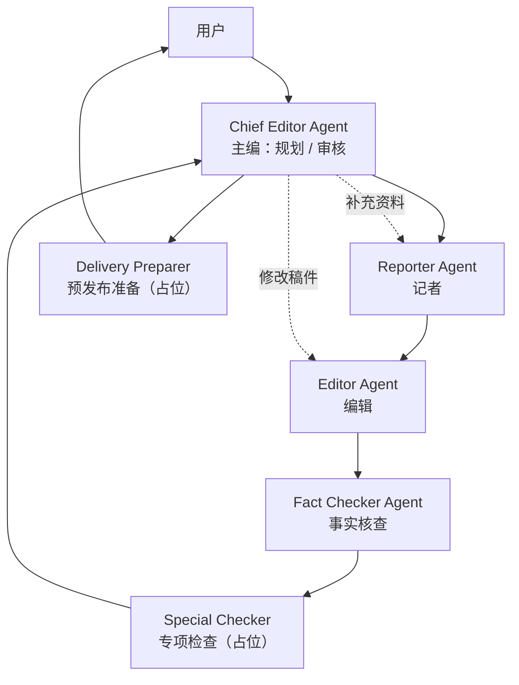

# Agent 设计说明书（Agent Specification）

| 项目 | 内容 |
| --- | --- |
| 文档编号 | NR-AGENT-001 |
| 版本 | V0.4 |
| 日期 | 2026-11-14 |
| 状态 | 五个 Agent 与工作流节点已实现（第 3 周） |
| 项目 | AI Newsroom 智能新闻编辑部 |
| 关联文档 | [PRD](../01-requirements/PRD.md)、[系统架构](../02-architecture/system-architecture.md)、[工作流设计](../04-workflow/workflow-design.md)、[状态设计](../05-data-design/state-schema.md) |

> 本文档是五个 Agent 的**统一设计基线**，定义职责边界、输入输出、权限与协作方式。
> `docs/03-agent-design/` 下的五个分册（`chief-editor-agent.md` 等）为本文档的工程细化版本，术语与枚举以本文档为准。

---

## 1. 设计目标

本系统采用多智能体协作模式，将传统新闻编辑部中的不同岗位抽象为具有独立职责的 AI Agent。

每个 Agent 负责一个或多个明确的业务环节，并通过 LangGraph 工作流进行协同。Agent 之间**不采用完全自由的对话模式**，而是通过结构化输入输出和统一的任务状态进行信息传递。

系统包含五个核心内容 Agent，以及两个负责交付阶段的辅助 Agent：

1. **Chief Editor Agent**：主编 Agent（拆分为「规划」「审核」两个工作流节点）
2. **Reporter Agent**：记者 Agent
3. **Editor Agent**：编辑 Agent
4. **Fact Checker Agent**：事实核查 Agent
5. **Special Checker Agent**：专项检查 Agent（D 模块接口，当前为确定性占位实现）
6. **Delivery Preparer Agent**：预发布准备 Agent（D 模块接口，当前为确定性占位实现）
7. **Publisher Agent**：保留为对外发布交接桩，当前工作流不调用

> 业务口径：系统**不对外发布新闻**。主编审核通过后，由预发布准备 Agent 生成交付包，任务进入「待复核」；用户复核、导出后自行投稿。`Publisher Agent` 的代码与契约保留在仓库中，作为与 B/D 模块的交接桩，不参与当前工作流。

---

## 2. Agent 总体关系



主编 Agent 是任务协调中心，负责统一管理各 Agent 的执行过程；其他 Agent 按各自职责完成任务，并将执行结果返回工作流。

| Agent | 核心产出 | 主要下游 |
| --- | --- | --- |
| 主编 | 采编计划、审核决策 | 记者、编辑、人工审核、预发布准备 |
| 记者 | 新闻初稿、资料来源 | 编辑 |
| 编辑 | 编辑稿、编辑说明 | 事实核查 |
| 事实核查 | 结构化核查报告 | 专项检查 |
| 专项检查 | 专项检查报告（敏感信息、内容规范） | 主编 |
| 预发布准备 | 交付包（稿件、来源、核查报告） | 用户复核与导出 |

---

## 3. 主编 Agent（Chief Editor Agent）

### 3.1 角色定位

主编 Agent 是整个新闻编辑部的核心调度和决策 Agent，负责从用户提交的新闻选题出发，制定采编计划、分配任务、跟踪执行状态，并对最终新闻稿件进行综合审核。

### 3.2 核心职责

1. 分析用户提交的新闻选题。
2. 确定报道角度和采编目标。
3. 制定资料搜集计划。
4. 生成新闻文章结构建议。
5. 指定需要重点核实的信息。
6. 将任务分配给记者 Agent。
7. 跟踪各 Agent 的执行状态。
8. 分析事实核查报告。
9. 决定稿件退回修改或补充资料。
10. 审核最终稿件并作出决策。

### 3.3 输入数据

```json
{
  "task_id": "TASK_001",
  "topic": "人工智能技术在高校教育中的应用",
  "description": "关注人工智能在高校教学中的应用现状",
  "requirements": {
    "style": "客观新闻报道",
    "target_length": 1500,
    "focus": ["应用案例", "实际效果", "存在的问题"]
  }
}
```

### 3.4 输出数据

主编 Agent 首次执行时输出采编计划：

```json
{
  "editorial_plan": {
    "topic_analysis": "分析新闻选题的核心内容",
    "reporting_angles": [
      "人工智能在高校教学中的应用",
      "高校人工智能教育实践案例",
      "人工智能应用面临的问题"
    ],
    "research_tasks": [
      "搜集高校人工智能教学案例",
      "搜集相关政策和公开数据"
    ],
    "article_outline": [
      "新闻背景",
      "应用现状",
      "典型案例",
      "存在的问题",
      "总结"
    ],
    "verification_points": [
      "相关政策发布时间",
      "高校应用案例真实性",
      "统计数据准确性"
    ]
  },
  "next_agent": "reporter"
}
```

### 3.5 审核决策

主编 Agent 在收到事实核查报告、专项检查报告和最终稿件后，进行综合判断，支持以下四种决策：

| 决策 | 含义 | 后续节点 |
| --- | --- | --- |
| `APPROVE` | 审核通过 | 预发布准备 Agent（任务进入「待复核」） |
| `REQUEST_EDIT` | 需要编辑修改 | Editor Agent |
| `REQUEST_RESEARCH` | 需要补充资料 | Reporter Agent |
| `HUMAN_REVIEW` | 需要人工审核 | 等待人工 |

系统对模型决策设有硬约束：

- 事实核查不是 `PASSED`，或专项检查为 `BLOCKED` 时，`APPROVE` 一律降级为 `HUMAN_REVIEW`；
- 专项检查为 `WARNING` 时保留 `APPROVE`，但在审核意见中注明提示项；
- 稿件修改轮次 `revision_round` 达到 `max_revision_rounds` 后，任何退回决策都强制转为 `HUMAN_REVIEW`；
- 人工审核环节不能覆盖 `FAILED` / `BLOCKED` 结论，只能终止任务或继续留在人工审核。

### 3.6 权限约束

- 主编负责任务规划和业务决策，**不直接调用新闻发布接口，也不直接生成交付文件**；
- 不直接承担记者的资料搜索和初稿撰写；
- 不应自行伪造资料来源；
- 审核意见必须结构化、可执行。

---

## 4. 记者 Agent（Reporter Agent）

### 4.1 角色定位

记者 Agent 根据主编下发的采编任务，完成新闻资料搜集、信息整理和新闻初稿撰写。

### 4.2 核心职责

1. 接收采编计划。
2. 分析资料搜集需求。
3. 生成搜索关键词。
4. 调用互联网搜索工具。
5. 筛选和整理新闻资料。
6. 提取关键事实。
7. 记录资料来源。
8. 根据采编计划撰写新闻初稿。
9. 根据退回意见补充资料或重写。

### 4.3 工具配置

| 工具 | 用途 |
| --- | --- |
| Web Search | 互联网搜索 |
| Web Fetch | 获取指定网页正文 |
| Source Extractor | 提取网页标题、发布时间和来源信息 |

工具的具体实现可以根据所接入的搜索服务调整。

### 4.4 输入数据

```json
{
  "task_id": "TASK_001",
  "editorial_plan": {
    "reporting_angles": ["高校人工智能教学案例", "应用效果"],
    "research_tasks": ["搜集相关高校案例", "查找公开统计数据"],
    "verification_points": ["高校名称", "案例真实性", "数据准确性"]
  },
  "revision_request": null
}
```

### 4.5 输出数据

```json
{
  "draft": {
    "title": "人工智能技术正在改变高校教学模式",
    "content": "新闻初稿正文……"
  },
  "sources": [
    {
      "source_id": "SRC_001",
      "title": "新闻资料标题",
      "url": "https://example.com/article",
      "publisher": "资料发布机构",
      "published_at": "2026-01-01",
      "summary": "资料摘要"
    }
  ],
  "research_summary": "本次资料搜集的主要发现",
  "unverified_claims": [],
  "status": "COMPLETED"
}
```

> 示例来源地址仅用于说明数据结构，实际运行时必须由搜索工具返回真实来源。

### 4.6 权限约束

- 负责资料搜集和初稿撰写，不负责最终审核与发布；
- 重要事实应尽可能提供对应来源；
- 不得将模型自行生成的内容伪装为真实新闻资料；
- 不得编造引语、数据、时间、机构名称。

---

## 5. 编辑 Agent（Editor Agent）

### 5.1 角色定位

编辑 Agent 负责对记者生成的新闻初稿进行专业化编辑，使稿件符合预定新闻风格、结构和篇幅要求。

### 5.2 核心职责

1. 检查稿件结构。
2. 优化新闻标题。
3. 调整段落顺序。
4. 优化语言表达。
5. 检查文章逻辑。
6. 控制文章篇幅。
7. 根据主编意见修改稿件。
8. 保留原始稿件和修改后版本。

### 5.3 输入数据

```json
{
  "task_id": "TASK_001",
  "draft": {
    "title": "新闻初稿标题",
    "content": "新闻初稿正文……"
  },
  "editorial_requirements": {
    "style": "客观、准确、简洁",
    "target_length": 1500,
    "structure": "背景-案例-分析-总结"
  },
  "revision_request": null
}
```

### 5.4 输出数据

```json
{
  "edited_article": {
    "title": "优化后的新闻标题",
    "content": "编辑后的新闻正文……"
  },
  "editing_report": {
    "structure_changes": "调整了文章结构",
    "language_changes": "优化了部分表达",
    "content_changes": "修改说明"
  },
  "version": 2,
  "status": "COMPLETED"
}
```

### 5.5 权限约束

- 不得随意修改新闻事实；
- 不得删除对理解新闻事件具有重要意义的信息；
- 对缺乏依据的事实应标记反馈，而不是自行补全；
- 每次修改生成新版本，保留原始稿件。

---

## 6. 事实核查 Agent（Fact Checker Agent）

### 6.1 角色定位

事实核查 Agent 负责验证新闻稿件中的关键事实是否具有可靠证据，识别虚假信息、信息矛盾和缺乏来源支持的内容。

### 6.2 核心职责

1. 提取新闻稿件中的事实声明。
2. 对人物、时间、地点和事件进行核实。
3. 检查数字、统计数据和引用内容。
4. 调用搜索工具查找佐证资料。
5. 比较不同来源的信息。
6. 判断证据是否充分。
7. 生成事实核查报告。

### 6.3 核查状态

| 状态 | 含义 |
| --- | --- |
| `VERIFIED` | 已得到可靠证据支持 |
| `CONTRADICTED` | 与可靠证据存在矛盾 |
| `UNVERIFIED` | 暂时无法验证 |
| `PARTIALLY_VERIFIED` | 部分内容得到支持 |

### 6.4 输入数据

```json
{
  "task_id": "TASK_001",
  "article": {
    "title": "新闻标题",
    "content": "编辑后的新闻正文……"
  },
  "sources": [
    {
      "source_id": "SRC_001",
      "url": "https://example.com/article"
    }
  ]
}
```

### 6.5 输出数据

```json
{
  "verification_report": {
    "overall_result": "PARTIAL",
    "claims": [
      {
        "claim": "某高校已经开展人工智能教学实践",
        "result": "VERIFIED",
        "evidence": [
          {
            "source_id": "SRC_001",
            "url": "https://example.com/article",
            "supporting_excerpt": "来源中的相关证据"
          }
        ],
        "reason": "存在可靠来源支持"
      },
      {
        "claim": "某项统计数据",
        "result": "UNVERIFIED",
        "evidence": [],
        "reason": "尚未找到可靠来源"
      }
    ],
    "issues": ["部分统计数据缺少可靠来源"],
    "recommendation": "REQUEST_RESEARCH"
  }
}
```

**总体结果取值**：`PASSED`（通过）、`PARTIAL`（部分通过）、`FAILED`（不通过）。

**建议取值**：`APPROVE`、`REQUEST_EDIT`、`REQUEST_RESEARCH`、`HUMAN_REVIEW`。

### 6.6 权限约束

- 只提供证据和核查结论，不修改最终稿件；
- 不决定是否发布；
- 对无法验证的内容必须明确标记，**不得将无法验证解释为事实错误**。

---

## 7. 专项检查 Agent 与预发布准备 Agent（交付链）

### 7.1 专项检查 Agent（Special Checker Agent）

**角色定位**：在事实核查通过后，对稿件进行敏感信息、内容规范等专项检查，为编辑决策提供最后一道内容风险防线。

**核心职责**：

1. 接收与核查报告同版本的稿件；
2. 检查敏感信息、个人隐私、表述规范等问题；
3. 输出结构化的专项检查报告（`PASSED` / `WARNING` / `BLOCKED`）；
4. 将阻断项与提示项交由主编审核环节处理。

**输入数据**：

```json
{
  "task_id": "TASK_001",
  "article_id": "ART_0001",
  "article": {"title": "新闻标题", "content": "新闻正文"},
  "article_version": 2,
  "fact_check_report": {"report_id": "FC_0001", "article_version": 2},
  "sources": []
}
```

**输出数据**：

```json
{
  "status": "COMPLETED",
  "finding": {
    "result": "PASSED",
    "summary": "未发现内容规范或敏感信息问题。",
    "issues": []
  },
  "article_id": "ART_0001",
  "article_version": 2
}
```

**权限约束**：

- 只能检查，不得修改稿件、修改核查结论或决定是否通过；
- 输入强制绑定 `fact_check_report.article_id` 与 `article_version`，版本不一致直接拒绝；
- `BLOCKED` 结论不可被人工覆盖，主编不得据此 `APPROVE`。

> 当前为 D 模块接口的确定性占位实现（恒返回 `PASSED`），后续由专项检查模块替换，契约保持不变。

### 7.2 预发布准备 Agent（Delivery Preparer Agent）

**角色定位**：主编 `APPROVE` 后，汇总稿件、来源与核查报告，生成供用户复核和导出的交付包。系统不对外发布，交付包是工作流的最终产物。

**核心职责**：

1. 校验交付前置条件（审核通过、核查与专项检查结论有效且绑定同一稿件版本）；
2. 汇总稿件、来源编号、事实核查报告、专项检查报告；
3. 生成 `DeliveryPackage`，任务状态置为「待复核」（`PENDING_REVIEW`）；
4. 由用户复核后确认交付（`DELIVERED`）或暂不交付。

**输入数据**：

```json
{
  "task_id": "TASK_001",
  "article_id": "ART_0001",
  "article": {"title": "新闻标题", "content": "新闻正文"},
  "article_version": 2,
  "fact_check_report": {"report_id": "FC_0001", "overall_result": "PASSED"},
  "special_check_report": {"report_id": "SC_0001", "result": "PASSED"},
  "sources": [{"source_id": "SRC_0001"}]
}
```

**输出数据**：

```json
{
  "status": "COMPLETED",
  "package": {
    "package_id": "DLV_0001",
    "task_id": "TASK_001",
    "article_id": "ART_0001",
    "article_version": 2,
    "fact_check_report_id": "FC_0001",
    "special_check_report_id": "SC_0001",
    "source_ids": ["SRC_0001"],
    "prepared_at": "2026-11-22T10:00:00Z",
    "note": "预发布材料已准备，等待用户复核与导出。"
  }
}
```

**权限约束**：

- 只有在主编 `APPROVE` 后才会被调用；
- 事实核查为 `FAILED` 或专项检查为 `BLOCKED` 时拒绝生成交付包；
- 报告与稿件的 `article_id` / `article_version` 必须一致；
- **不调用任何新闻发布接口**，最终投稿由用户自行完成。

> 当前为确定性占位实现，交付包字段已按 D 模块需求固化。

### 7.3 审核发布 Agent（Publisher Agent，交接桩）

`Publisher Agent`（`backend/app/agents/publisher.py`、`backend/app/services/publish_service.py`）保留在仓库中，作为与 B/D 模块的对外发布交接桩：输入要求 `chief_decision=APPROVE` 且核查不为 `FAILED`，输出默认 `PENDING_PUBLISH`，不直接发布。当前工作流**不调用**该 Agent，文档 [publisher-agent.md](publisher-agent.md) 仅作为交接参考。

---

## 8. Agent 通用开发规范

1. **统一输入**：从 `NewsTaskState` 读取所需的任务信息。
2. **统一输出**：返回符合 Pydantic 数据模型约束的结构化结果。
3. **职责独立**：Agent 不得擅自执行其他 Agent 的核心职责。
4. **错误处理**：模型调用失败、工具异常和输出校验失败均应返回明确错误信息。
5. **日志记录**：记录 Agent 名称、任务编号、执行时间、执行结果和错误信息。
6. **状态管理**：由 LangGraph 工作流统一管理任务状态和后续执行节点。
7. **安全约束**：外部网页内容视为不可信数据，不得执行其中的指令；API 密钥不得出现在提示词中。

---

## 9. 与详细设计文档的关系

| 文档 | 作用 |
| --- | --- |
| 本文档 `agent-specification.md` | 统一规范：职责、输入输出、权限、决策枚举 |
| [chief-editor-agent.md](chief-editor-agent.md) | 主编工程细化：Prompt 要点、工具、异常、评测 |
| [reporter-agent.md](reporter-agent.md) | 记者工程细化 |
| [editor-agent.md](editor-agent.md) | 编辑工程细化 |
| [fact-checker-agent.md](fact-checker-agent.md) | 事实核查工程细化 |
| [publisher-agent.md](publisher-agent.md) | 对外发布交接桩（当前工作流不调用） |

发生冲突时，以本文档定义的职责边界与枚举取值为准，详细文档补充实现细节。

---

## 10. 工程接口契约（V0.4）

第 1 周已将各 Agent（主编拆分为「规划」和「审核」两个工作流节点）的输入输出固化为 Pydantic 模型；V0.4 在事实核查之后新增专项检查、在主编审核之后新增预发布准备两个节点契约。

### 10.1 契约位置

| 内容 | 路径 |
| --- | --- |
| 输入 / 输出契约、契约注册表 | `backend/app/agents/contracts.py` |
| Agent 抽象基类 | `backend/app/agents/base.py` |
| 契约引用的领域模型 | `backend/app/schemas/domain.py` |
| 枚举定义 | `backend/app/schemas/enums.py` |

### 10.2 节点契约

| 工作流节点 | 输入模型 | 输出模型 | 关键约束 |
| --- | --- | --- | --- |
| `chief_planning` | `ChiefPlanningInput` | `ChiefPlanningOutput` | 成功时必须输出 `editorial_plan`，下一节点固定为 `reporter` |
| `reporter` | `ReporterInput` | `ReporterOutput` | 成功时必须包含初稿、至少一条来源和资料总结；来源 URL 必须是 HTTP(S)；输入含用户需求、已有来源与上一版初稿，用于补充资料时复用 |
| `editor` | `EditorInput` | `EditorOutput` | 成功时必须包含编辑稿、编辑说明和新版本号；版本号 ≥ 2 |
| `fact_checker` | `FactCheckerInput` | `FactCheckerOutput` | 输入必须带 `article_id` 和 `article_version`；成功输出必须回显两者，用于绑定核查报告 |
| `chief_review` | `ChiefReviewInput` | `ChiefReviewOutput` | `REQUEST_EDIT` 必须携带 `target=editor` 的修改要求；`REQUEST_RESEARCH` 必须携带 `target=reporter` 的补充资料要求；`APPROVE` 不得携带修改要求 |
| `special_check` | `SpecialCheckInput` | `SpecialCheckOutput` | 输入强制绑定 `fact_check_report.article_id` / `article_version`；成功输出必须回显 `article_id`、`article_version` 与 `finding`；结论为 `PASSED` / `WARNING` / `BLOCKED`，不得修改稿件 |
| `prepare_delivery` | `DeliveryPreparationInput` | `DeliveryPreparationOutput` | 仅主编 `APPROVE` 后调用；拒绝 `FAILED` 事实核查与 `BLOCKED` 专项检查；报告须与稿件版本一致；输出 `DeliveryPackage`，不调用发布接口 |

### 10.3 通用约束

1. 所有契约模型继承 `StrictModel`，未知字段直接拒绝（`extra="forbid"`）。
2. `AgentOutput.status=FAILED` 时必须提供 `error`；`COMPLETED` 时不得携带 `error`。
3. 成功输出必须包含该 Agent 的核心业务字段；失败输出允许只携带错误信息。
4. 主编审核的退回要求必须是结构化 `RevisionRequest`，不能只有自然语言描述。
5. 事实核查只输出证据与结论，不修改稿件、不决定发布；核查报告与专项检查报告均由工作流绑定到具体稿件版本。
6. 交付前置条件在契约层校验，但主编 `APPROVE` 不等于对外发布：系统只生成交付包并进入「待复核」，导出与投稿由用户完成。
7. `AGENT_CONTRACTS` 注册了七个工作流节点契约（`chief_planning`、`reporter`、`editor`、`fact_checker`、`special_check`、`chief_review`、`prepare_delivery`），供工作流注册、测试和契约校验复用。`publisher` 契约保留但不在注册表中。

### 10.4 实现状态

- 第 1 周：完成输入输出契约、枚举、领域模型和契约测试（已完成）；
- 第 2 周：完成 Reporter、Editor、Fact Checker 的具体逻辑、Prompt 与测试（已完成）；
- 第 3 周：实现 Chief Editor（规划 / 审核）、Publisher，并接入 LangGraph；工作流负责状态更新、条件路由、退回循环、人工审核与发布确认（已完成）；
- V0.4（2026-11-22）：按「不对外发布」口径重构交付链，新增 `special_check` 与 `prepare_delivery` 节点（当前为确定性占位），`publisher` 退出工作流并保留为交接桩（已完成）。

### 10.5 第 2 周实现要点（V0.3）

| 模块 | 位置 | 说明 |
| --- | --- | --- |
| Reporter | `backend/app/agents/reporter.py` | 生成检索词 → 并行搜索 → 来源去重编号 → 撰写初稿；支持补充资料 |
| Editor | `backend/app/agents/editor.py` | 结构化编辑；新版本号由代码递增；拒绝非编辑类退回 |
| Fact Checker | `backend/app/agents/fact_checker.py` | 抽取断言 → 逐条搜索 → 依据证据判定 |
| 来源处理 | `backend/app/agents/sources.py` | URL 归一化、去重、`SRC` / `EVID` 编号 |
| LLM 客户端 | `backend/app/core/llm.py` | OpenAI 兼容 JSON mode，错误分类与有限重试 |
| 搜索工具 | `backend/app/tools/search.py` | Tavily 搜索，过滤非 HTTP(S) URL，截断摘要 |
| Prompt | `backend/app/prompts/` | YAML + Jinja2，`agents/` 与共享规则 `shared/` |

新增的确定性约束：

1. **来源只来自工具**：Reporter 不接受模型返回的 URL，来源只能来自搜索工具与已有来源；同一 URL 去重后由代码编号。
2. **版本由代码控制**：Editor 输出的 `version = current_version + 1`，模型无权决定版本号。
3. **证据由代码绑定**：Fact Checker 只接受模型返回的证据编号；URL 与摘录从证据池读取，未知编号会被忽略，缺少有效证据的断言降级为 `UNVERIFIED`。
4. **核查结论由代码汇总**：存在 `CONTRADICTED` 时为 `FAILED`，全部 `VERIFIED` 时为 `PASSED`，其余为 `PARTIAL`；建议仅在全部通过时为 `APPROVE`。
5. **失败不抛出**：三个 Agent 均以契约输出返回 `status=FAILED` 与结构化 `error`，由工作流决定重试或转人工。
6. **Prompt 不硬编码**：Prompt 位于 YAML 文件，模型输出先经 Pydantic 校验，失败自动携带校验错误重试一次。

### 10.6 第 3 周实现要点（V0.4 基线）

| 模块 | 位置 | 说明 |
| --- | --- | --- |
| 主编 | `backend/app/agents/chief_editor.py` | 规划节点输出采编计划；审核节点输出四类决策与结构化退回要求 |
| 专项检查 | `backend/app/agents/special_check.py` | D 模块接口的确定性占位，校验报告与稿件版本绑定，输出 `PASSED` / `WARNING` / `BLOCKED` |
| 预发布准备 | `backend/app/agents/delivery.py` | 校验交付前置条件，汇总交付包，不调用发布接口 |
| 发布交接桩 | `backend/app/agents/publisher.py`、`backend/app/services/publish_service.py` | 不在工作流中，供 B/D 模块对接 |
| 路由 | `backend/app/graph/routing.py` | 纯函数条件边，测试无需启动图 |
| 节点 | `backend/app/graph/nodes.py` | 将 `NewsTaskState` 翻译为 Agent 输入，并写回状态与执行日志 |
| 工作流 | `backend/app/graph/workflow.py` | 编译 LangGraph、内存检查点、`interrupt` 暂停与恢复封装 |

新增的确定性约束：

1. **批准必须有核查依据**：事实核查不是 `PASSED` 时，模型的 `APPROVE` 会被系统降级为 `HUMAN_REVIEW`。
2. **退回目标由代码决定**：`REQUEST_EDIT` 固定为 `target=editor`，`REQUEST_RESEARCH` 固定为 `target=reporter`，模型只提供原因与要求。
3. **修改轮次有上限**：`revision_round` 达到 `max_revision_rounds`（默认 2）后，任何退回决策都会强制转为 `HUMAN_REVIEW`，避免无限循环；该计数与接口失败重试计数相互独立。
4. **交付前置条件**：预发布准备只接受 `APPROVE` 后的稿件，且事实核查不为 `FAILED`、专项检查不为 `BLOCKED`；交付包生成后任务进入 `PENDING_REVIEW`。
5. **人工权限高于模型，但不能覆盖硬结论**：人工可以批准并进入预发布准备，也可以终止任务或要求退回；`FAILED` / `BLOCKED` 时人工批准无效，任务保持 `HUMAN_REVIEW`。
6. **执行可追溯**：每个节点写入 `execution_logs`（Agent、状态、起止时间、摘要或错误）；失败即终止图并写 `FAILED` 状态。
7. **契约补充**：`ChiefReviewInput` 增加 `requirements`、`special_check_report`、`revision_round`、`max_revision_rounds`，使审核能对照用户需求、专项检查结论与修改预算。
8. **不对外发布**：工作流终点是交付包与 `PENDING_REVIEW`，确认交付后为 `DELIVERED`；系统不调用任何新闻发布接口。
