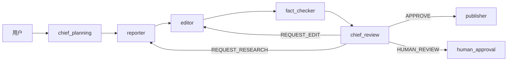

# 主编 Agent 详细设计

| 项目 | 内容 |
| --- | --- |
| Agent ID | `chief_editor` |
| 对应节点 | `chief_planning`（采编计划）、`chief_review`（综合审核） |
| 版本 | V0.1 |
| 日期 | 2026-11-13 |
| 统一规范 | [agent-specification.md](agent-specification.md) |

> 本文档是 [Agent 设计说明书](agent-specification.md) 第 3 章的工程细化；职责边界、决策枚举以统一规范为准。

---

## 1. 职责与目标

主编 Agent 是任务规划与协调中心，承担「策划」与「综合审核」两项职责，不参与资料搜集和正文写作。

| 节点 | 目标 |
| --- | --- |
| `chief_planning` | 分析选题，输出结构化采编计划：选题分析、报道角度、资料搜集任务、文章结构、重点核查信息。 |
| `chief_review` | 结合采编计划、资料来源、编辑稿和核查报告，输出明确审核决策。 |

**不做什么**

- 不搜集资料、不撰写或改写正文；
- 不替代事实核查 Agent 做逐条事实判断；
- 不直接调用发布接口。

---

## 2. 输入

主要读取 `NewsTaskState`：

| 字段 | 节点 | 说明 |
| --- | --- | --- |
| `task_id` | 两者 | 任务编号 |
| `topic` | `chief_planning` | 新闻选题 |
| `description` | `chief_planning` | 选题背景描述 |
| `requirements` | `chief_planning` | `style`、`target_length`、`focus` |
| `editorial_plan` | `chief_review` | 原始采编计划 |
| `research_sources` / `research_summary` | `chief_review` | 记者资料 |
| `edited_article` | `chief_review` | 当前编辑稿 |
| `fact_check_report` | `chief_review` | 事实核查报告 |
| `revision_request` / 历史意见 | `chief_review` | 已执行过的退回要求 |

---

## 3. 输出

### 3.1 采编计划（`chief_planning`）

```json
{
  "editorial_plan": {
    "topic_analysis": "分析新闻选题的核心内容",
    "reporting_angles": ["报道角度1", "报道角度2"],
    "research_tasks": ["资料搜集任务1", "资料搜集任务2"],
    "article_outline": ["新闻背景", "应用现状", "典型案例", "存在的问题", "总结"],
    "verification_points": ["需要重点核实的信息1", "信息2"]
  },
  "next_agent": "reporter"
}
```

### 3.2 审核决策（`chief_review`）

```json
{
  "chief_decision": "REQUEST_RESEARCH",
  "review_comments": "核心数据缺少权威来源，请补充官方统计。",
  "revision_request": {
    "target": "reporter",
    "reason": "关键数据无可靠来源",
    "requirements": ["补充官方统计数据来源", "核对报道中的百分比"],
    "related_claims": ["C3", "C7"]
  }
}
```

决策取值：

| 决策 | 含义 | 后续节点 |
| --- | --- | --- |
| `APPROVE` | 审核通过 | `publisher` |
| `REQUEST_EDIT` | 表达、结构或风格问题 | `editor` |
| `REQUEST_RESEARCH` | 事实错误、资料不足或来源不可靠 | `reporter` |
| `HUMAN_REVIEW` | 存在争议或关键信息无法确定 | `human_approval` |

---

## 4. System Prompt 要点

1. **角色**：资深新闻主编，负责策划与终审，不执笔。
2. **计划要求**：报道角度具体；搜集任务可直接执行；核查点明确。
3. **审核依据**：以事实核查报告为核心，结合原始采编计划判断回应度。
4. **路由判断**：
   - 事实错误 / 无来源 / 资料不足 → `REQUEST_RESEARCH`；
   - 结构、表达、标题问题 → `REQUEST_EDIT`；
   - 核查争议或关键信息无法确定 → `HUMAN_REVIEW`；
   - 无阻断问题 → `APPROVE`。
5. **退回意见**：必须结构化（目标、原因、具体要求），禁止空泛意见。
6. **事实边界**：不自行改写稿件，不编造资料。
7. **输出**：严格 JSON，符合 Schema。

完整 Prompt 模板见 [prompt-design.md](../07-prompts/prompt-design.md)。

---

## 5. 可调用工具

| 工具 | 用途 | 约束 |
| --- | --- | --- |
| `get_task_context` | 读取任务、历史意见 | 只读 |
| `get_fact_check_report` | 读取核查报告 | 只读 |

主编不调用搜索与抓取工具，避免与记者职责重叠。

---

## 6. 执行约束

| 约束 | 说明 |
| --- | --- |
| 输出可解析 | Pydantic 校验，失败重试 ≤ 1 次 |
| 计划完整性 | 五个字段均非空，`reporting_angles` / `research_tasks` / `article_outline` / `verification_points` 至少 1 项 |
| 决策合法 | 只能是四种枚举值，禁止自由文本决策 |
| 退回必带要求 | `REQUEST_EDIT` / `REQUEST_RESEARCH` 必须提供 `revision_request` |
| 退回上限 | 由工作流的 `retry_count` 控制；超过上限强制 `HUMAN_REVIEW` |
| 不越权 | 不修改稿件、不修改核查报告、不调用发布接口 |

---

## 7. 异常处理

| 异常 | 处理 |
| --- | --- |
| JSON 解析 / Schema 失败 | 携带错误重试 1 次；仍失败节点失败 |
| 决策无法识别 | 不猜测，抛 `InvalidDecisionError`，转人工 |
| 计划字段缺失 | 重试 1 次；仍缺失转人工 |
| LLM 超时 / 限流 | 退避重试 2 次；仍失败任务 `FAILED` 可恢复 |
| 上游数据缺失 | 抛 `MissingUpstreamData`，不得凭空审核 |

---

## 8. 与其他 Agent 的交互



| 对象 | 关系 | 数据 |
| --- | --- | --- |
| 记者 | 下游 | `editorial_plan`、`revision_request(target=reporter)` |
| 编辑 | 下游 | `revision_request(target=editor)` |
| 事实核查 | 上游 | 消费其报告 |
| 人工审核 | 下游 | `HUMAN_REVIEW` 决策 |

---

## 9. 评测要点

- 计划完整性：五个字段齐全率 100%；
- 决策一致性：同一输入重复审核一致率 ≥ 90%；
- 路由正确率：与人工标注决策一致率 ≥ 90%；
- 退回有效性：修订要求可执行率 ≥ 85%。
