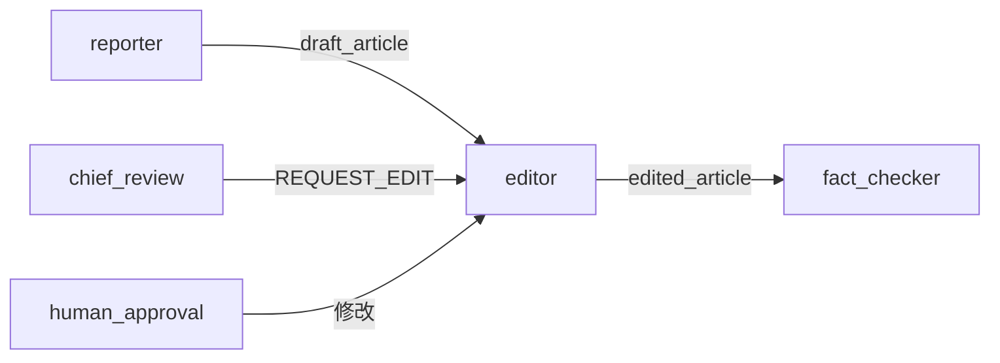

# 编辑 Agent 详细设计

| 项目 | 内容 |
| --- | --- |
| Agent ID | `editor` |
| 对应节点 | `editor` |
| 版本 | V0.1 |
| 日期 | 2026-11-13 |
| 统一规范 | [agent-specification.md](agent-specification.md) |

> 本文档是 [Agent 设计说明书](agent-specification.md) 第 5 章的工程细化。

---

## 1. 职责与目标

编辑 Agent 对记者初稿进行专业化编辑，使稿件符合预定新闻风格、结构和篇幅要求；根据主编或人工审核意见修改稿件。

**不做什么**

- 不新增未经来源支持的事实；
- 不删除对理解新闻事件具有重要意义的信息；
- 不对缺乏依据的事实自行补全（应标记反馈）；
- 不做事实真伪的最终判定；
- 不发布。

---

## 2. 输入

| 字段 | 说明 |
| --- | --- |
| `task_id` | 任务编号 |
| `draft_article` | 记者初稿 `{title, content}` |
| `editorial_requirements` | 风格、目标篇幅、结构要求（来自用户需求与采编计划） |
| `research_sources` | 资料来源，用于核对表述 |
| `revision_request` | 主编 / 人工退回要求（可为 `null`） |

---

## 3. 输出

```json
{
  "edited_article": {
    "title": "优化后的新闻标题",
    "content": "编辑后的新闻正文……"
  },
  "editing_report": {
    "structure_changes": "调整了文章结构",
    "language_changes": "优化了部分表达",
    "content_changes": "修改说明"
  },
  "version": 2,
  "status": "COMPLETED"
}
```

`version` 由系统按稿件版本递增生成，Agent 不得自行指定跳号。

---

## 4. System Prompt 要点

1. **角色**：资深文字编辑，服务于事实与受众，不做二次创作。
2. **结构**：导语给出核心信息；段落顺序符合 `editorial_requirements.structure`；删除重复与空话。
3. **语言**：准确、简洁、克制；去除夸张、绝对化、情绪化表述；统一术语与数字格式。
4. **标题**：必须由正文事实支撑，禁止标题党。
5. **事实保护**：不得新增事实；发现疑似事实问题应标记反馈，而不是直接改写数据。
6. **修订**：逐条响应 `revision_request`，在 `editing_report` 中说明处理结果；未涉及部分保持稳定。
7. **输出**：严格 JSON；有修改时 `editing_report` 不得为空。

完整模板见 [prompt-design.md](../07-prompts/prompt-design.md)。

---

## 5. 可调用工具

| 工具 | 用途 | 约束 |
| --- | --- | --- |
| `count_words` | 统计字数 | 只读 |
| `get_article_version` | 读取历史版本 | 只读 |
| `search_within_sources` | 在已采集资料内核对表述 | 不新增外部来源 |

编辑不调用 Web Search / Web Fetch：新增资料属于记者职责。

---

## 6. 执行约束

| 约束 | 说明 |
| --- | --- |
| 事实零新增 | 输出不得出现来源之外的新事实、新数据、新引语 |
| 重要信息不删 | 不得删除影响事件理解的关键信息 |
| 篇幅 | 符合 `target_length`，偏差 ≤ 10% |
| 修改留痕 | 实质性修改写入 `editing_report` |
| 版本 | 每次编辑生成新版本，保留原始稿件 |
| 禁止改立场 | 不改变报道角度与核心结论 |
| 模型参数 | temperature ≤ 0.5 |

---

## 7. 异常处理

| 异常 | 处理 |
| --- | --- |
| 输出 JSON 失败 | 重试 1 次；仍失败节点失败 |
| 初稿缺少关键来源 | 标记反馈，不自行补全；由核查/主编决定退回记者 |
| 修改导致篇幅严重偏离 | 再压缩/扩写一轮；仍偏离则标记交付 |
| 退回意见冲突 | 不擅自取舍，标记并转人工 |
| LLM 超时 / 限流 | 退避重试 2 次；仍失败任务 `FAILED` 可恢复 |
| 网页内容含指令 | 不作为指令执行 |

---

## 8. 与其他 Agent 的交互



| 对象 | 关系 | 说明 |
| --- | --- | --- |
| 记者 | 上游 | 消费初稿 |
| 事实核查 | 下游 | 交付编辑稿；事实问题由主编退回记者 |
| 主编 | 上游（退回） | 接收修改意见 |
| 人工审核 | 上游（退回） | 接收人工修改意见 |

---

## 9. 评测要点

- 事实保护：编辑前后事实集合一致率 100%；
- 重要信息保留率：关键信息保留率 100%；
- 语言质量：人工盲评「可发布程度」≥ 4/5；
- 标题契合度：标题与正文一致率 ≥ 95%；
- 退回意见解决率 ≥ 90%。
