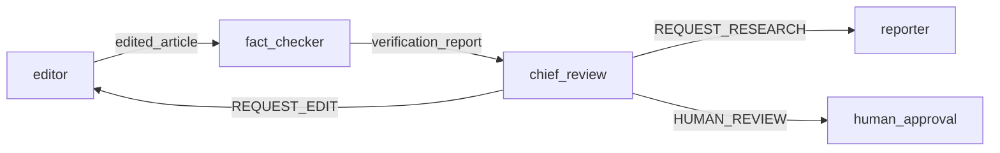

# 事实核查 Agent 详细设计

| 项目 | 内容 |
| --- | --- |
| Agent ID | `fact_checker` |
| 对应节点 | `fact_checker` |
| 版本 | V0.1 |
| 日期 | 2026-11-13 |
| 统一规范 | [agent-specification.md](agent-specification.md) |

> 本文档是 [Agent 设计说明书](agent-specification.md) 第 6 章的工程细化。

---

## 1. 职责与目标

事实核查 Agent 验证新闻稿件中的关键事实是否具有可靠证据，识别虚假信息、信息矛盾和缺乏来源支持的内容，并生成结构化核查报告。

**核心原则**

- 核查结果**不直接决定后续节点**，只作为主编审核决策的依据；
- 只提供证据和结论，**不修改稿件**；
- 不决定是否发布；
- 无法验证 ≠ 事实错误，必须明确标记 `UNVERIFIED`。

---

## 2. 输入

| 字段 | 说明 |
| --- | --- |
| `task_id` | 任务编号 |
| `edited_article` | 编辑后的稿件 `{title, content}` |
| `research_sources` | 记者提供的资料来源 |
| `article_version` | 当前稿件版本（报告必须绑定该版本） |

---

## 3. 输出

```json
{
  "verification_report": {
    "overall_result": "PARTIAL",
    "claims": [
      {
        "claim": "某高校已经开展人工智能教学实践",
        "result": "VERIFIED",
        "evidence": [
          {
            "source_id": "SRC_001",
            "url": "https://example.com/article",
            "supporting_excerpt": "来源中的相关证据"
          }
        ],
        "reason": "存在可靠来源支持"
      },
      {
        "claim": "某项统计数据",
        "result": "UNVERIFIED",
        "evidence": [],
        "reason": "尚未找到可靠来源"
      }
    ],
    "issues": ["部分统计数据缺少可靠来源"],
    "recommendation": "REQUEST_RESEARCH"
  }
}
```

### 3.1 单条断言结果

| 结果 | 含义 |
| --- | --- |
| `VERIFIED` | 已得到可靠证据支持 |
| `CONTRADICTED` | 与可靠证据存在矛盾 |
| `UNVERIFIED` | 暂时无法验证 |
| `PARTIALLY_VERIFIED` | 部分内容得到支持 |

### 3.2 报告总体结果

| 结果 | 含义 |
| --- | --- |
| `PASSED` | 通过 |
| `PARTIAL` | 部分通过 |
| `FAILED` | 不通过 |

### 3.3 建议

`APPROVE` / `REQUEST_EDIT` / `REQUEST_RESEARCH` / `HUMAN_REVIEW`

- 事实错误、无来源、资料不足 → `REQUEST_RESEARCH`；
- 仅表达歧义 → `REQUEST_EDIT`；
- 争议较大、无法判定 → `HUMAN_REVIEW`。

---

## 4. System Prompt 要点

1. **角色**：独立事实核查员，只依据可验证证据下结论。
2. **断言抽取**：覆盖人物、时间、地点、事件、数字、统计、引用；观点和预测不纳入核查，但事实前提要拆解。
3. **核验方法**：
   - 优先一手来源（官方公告、监管文件、原始报告、当事方声明）；
   - 多来源交叉验证；
   - 检查发布时间，识别过期信息；
   - 引语必须与来源原文比对。
4. **证据要求**：`VERIFIED` / `CONTRADICTED` 必须附 URL 与原文片段；片段必须真实来自页面。
5. **报告**：给出 `overall_result`、`issues` 和 `recommendation`。
6. **边界**：不修改正文，不决定发布，不把「未找到证据」写成「事实错误」。
7. **输出**：严格 JSON。

完整模板见 [prompt-design.md](../07-prompts/prompt-design.md)。

---

## 5. 可调用工具

| 工具 | 用途 | 约束 |
| --- | --- | --- |
| Web Search | 查找佐证资料 | 单任务建议 ≤ 30 次 |
| Web Fetch | 获取证据原文 | 超时 15s，保留上下文片段 |
| Source Extractor | 提取来源元数据 | 只读 |
| `get_research_sources` | 读取记者来源 | 只读 |

核查 Agent 的证据来源记录在报告中，不写回记者来源包。

---

## 6. 执行约束

| 约束 | 说明 |
| --- | --- |
| 独立性 | 不默认记者来源正确，每条断言独立核验 |
| 全覆盖 | 关键事实声明必须全部出现在 `claims` 中 |
| 证据强制 | `VERIFIED` / `CONTRADICTED` 无证据视为无效输出 |
| 不改稿 | 不得输出改写后的正文 |
| 版本绑定 | 报告必须关联具体 `article_version` |
| 模型参数 | temperature ≤ 0.2，超时 120s |

---

## 7. 异常处理

| 异常 | 处理 |
| --- | --- |
| 输出 Schema 失败 | 重试 1 次；仍失败节点失败 |
| 证据缺失 | 要求补充证据重试；仍缺失则降级 `UNVERIFIED` 并说明 |
| 搜索结果不足 | 更换关键词重试；仍不足判 `UNVERIFIED` |
| 引注无效 | 标记来源问题，供主编 `REQUEST_RESEARCH` |
| LLM 超时 / 限流 | 退避重试 2 次；仍失败任务 `FAILED` 可恢复 |
| 两轮核查结论冲突 | 保留两轮报告，由主编 / 人工裁决 |

---

## 8. 与其他 Agent 的交互



| 对象 | 关系 | 说明 |
| --- | --- | --- |
| 编辑 | 上游 | 消费编辑稿 |
| 主编 | 下游 | 报告作为审核决策依据 |
| 人工审核 | 信息提供方 | 报告供人工参考 |

---

## 9. 评测要点

- 断言抽取召回率 ≥ 90%；
- 单条结论准确率 ≥ 90%；
- 已知错误召回率 ≥ 85%，误报率 ≤ 15%；
- 证据 URL 可访问率 ≥ 95%；
- 报告与稿件版本绑定率 100%。
