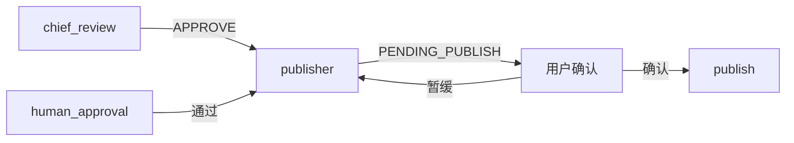

# 审核发布 Agent 详细设计

| 项目 | 内容 |
| --- | --- |
| Agent ID | `publisher` |
| 对应节点 | `publisher`（待发布管理）、`publish`（执行发布） |
| 版本 | V0.1 |
| 日期 | 2026-11-13 |
| 统一规范 | [agent-specification.md](agent-specification.md) |

> 本文档是 [Agent 设计说明书](agent-specification.md) 第 7 章的工程细化。

---

## 1. 职责与目标

审核发布 Agent 负责执行主编审核通过后的稿件发布管理工作，连接 AI 审核结果与最终发布操作。

| 节点 | 目标 |
| --- | --- |
| `publisher` | 检查发布前置条件，创建待发布记录，等待用户确认 |
| `publish` | 用户确认后调用发布接口，保存发布结果 |

**不做什么**

- 不拥有独立决定新闻内容是否合格的权限；
- 不修改稿件内容；
- 不绕过主编审核；
- 不在用户确认前正式发布。

---

## 2. 输入

| 字段 | 说明 |
| --- | --- |
| `task_id` | 任务编号 |
| `article` / `edited_article` | 最终稿件 |
| `article_version` | 最终稿件版本 |
| `chief_decision` | 必须为 `APPROVE` |
| `fact_check_status` | 核查总体结果，不得为 `FAILED` |
| `user_confirmation` | 用户是否明确确认发布 |
| `publication` | 已有待发布记录（重试时） |

---

## 3. 输出

### 3.1 待发布（`publisher`）

```json
{
  "publication": {
    "status": "PENDING_PUBLISH",
    "publication_id": "PUB_001",
    "article_id": "ARTICLE_001",
    "article_version": 2,
    "published_at": null,
    "external_url": null,
    "message": "稿件已进入待发布状态，等待用户确认"
  }
}
```

### 3.2 发布结果（`publish`）

成功：

```json
{
  "publication": {
    "status": "PUBLISHED",
    "publication_id": "PUB_001",
    "article_id": "ARTICLE_001",
    "article_version": 2,
    "published_at": "2026-11-13T16:30:00+08:00",
    "external_url": "https://mock.example.com/news/ARTICLE_001",
    "message": "发布成功"
  }
}
```

失败：

```json
{
  "publication": {
    "status": "FAILED",
    "publication_id": "PUB_001",
    "article_id": "ARTICLE_001",
    "article_version": 2,
    "published_at": null,
    "external_url": null,
    "message": "发布接口超时，请稍后重试"
  }
}
```

> 发布失败时任务仍保持 `PENDING_PUBLISH`，保留稿件与待发布记录，允许重试。

---

## 4. System Prompt / 规则要点

审核发布以**规则校验**为主，LLM 仅用于生成说明文本，不参与是否发布的判断。

1. 校验 `chief_decision == "APPROVE"`；
2. 校验 `fact_check_status != "FAILED"`；
3. 校验稿件版本与核查报告版本一致；
4. 校验 `user_confirmation == true` 才调用发布接口；
5. 发布结果必须落库；
6. 重复调用幂等。

---

## 5. 可调用工具

| 工具 | 用途 | 约束 |
| --- | --- | --- |
| `create_publication_record` | 创建待发布记录 | 幂等（article_id + version） |
| `get_publication` | 查询发布记录 | 只读 |
| `publish_to_channel` | 调用发布接口 | 超时 30s；幂等 |
| `notify_user` | 通知用户 | 不包含敏感信息 |

---

## 6. 执行约束

| 约束 | 说明 |
| --- | --- |
| 主编前置 | 仅接受 `APPROVE` |
| 核查前置 | `overall_result` 不得为 `FAILED` |
| 版本一致 | 发布版本必须与最新核查报告版本一致 |
| 用户确认 | `user_confirmation=false` 时禁止发布 |
| 幂等 | 同一 `article_id + article_version` 只产生一条发布记录 |
| 零改写 | 发布内容与终稿一致 |
| 部分失败 | 记录错误，保持待发布，可重试 |

---

## 7. 异常处理

| 异常 | 处理 |
| --- | --- |
| 前置条件不满足 | 拒绝进入发布，返回明确原因 |
| 用户未确认 | 保持 `PENDING_PUBLISH` |
| 发布接口超时 / 报错 | 重试 2 次；仍失败记录 `FAILED`，允许人工重试 |
| 重复确认 | 幂等返回已有发布记录 |
| 核查版本与稿件版本不一致 | 拒绝发布，要求重新核查 |
| 通知失败 | 记录错误，不阻塞任务状态 |
| 数据库写入失败 | 回滚发布状态更新，避免「已发布无记录」 |

---

## 8. 与其他 Agent 的交互



| 对象 | 关系 | 说明 |
| --- | --- | --- |
| 主编 | 上游 | 提供 `APPROVE` 决策 |
| 人工审核 | 上游 | 人工通过后进入 |
| 用户 | 下游 | 确认发布 |
| 发布渠道 | 外部 | 首期 Mock 适配器 |

---

## 9. 评测要点

- 未审核发布拦截率 100%；
- 未确认发布拦截率 100%；
- 版本一致校验命中率 100%；
- 幂等：重复确认不产生重复发布记录；
- 发布失败可重试率 100%。
