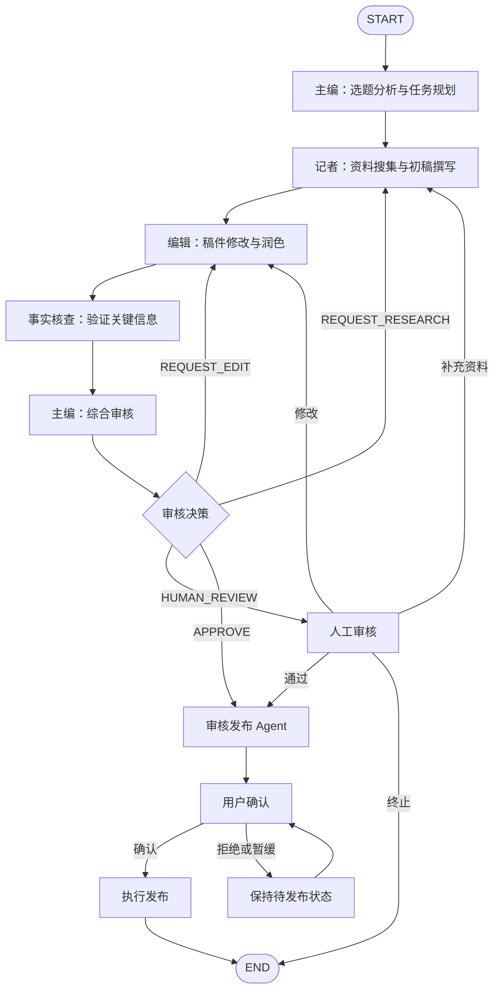
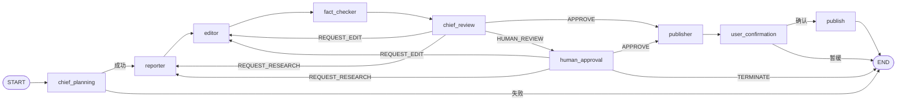

# AI Newsroom 智能新闻编辑部 — 工作流设计文档（Workflow Design）

| 项目 | 内容 |
| --- | --- |
| 文档编号 | NR-WF-001 |
| 文档版本 | V0.2 |
| 工作流框架 | LangGraph |
| 日期 | 2026-11-14 |
| 状态 | 已实现并接入内存检查点（第 3 周） |
| 关联文档 | [Agent 设计](../03-agent-design/agent-specification.md)、[状态设计](../05-data-design/state-schema.md)、[API 规范](../06-api/api-specification.md) |

> **关键原则**：Agent 的执行顺序与 Agent 的决策权不是一回事。
> 记者完成后进入编辑，编辑完成后进入事实核查；但事实核查完成后**不应自动进入发布**，必须先回到主编进行决策。

---

## 1. 工作流设计目标

系统采用 LangGraph 构建多智能体协作工作流，将新闻采编任务拆分为多个独立执行节点，通过节点之间的连接关系和条件路由实现任务调度。

工作流需要支持：

- 正常顺序执行；
- 条件判断；
- 任务退回；
- 循环修改；
- 异常处理；
- 人工审核；
- 中断恢复。

系统不采用完全自由的 Agent 对话模式，而是由**主编 Agent 进行业务决策**，由 **LangGraph 负责实际的节点调度和状态流转**。

---

## 2. 工作流总体结构

| 节点名称 | 对应组件 | 主要职责 |
| --- | --- | --- |
| `START` | 系统入口 | 接收新闻任务 |
| `chief_planning` | 主编 Agent | 选题分析和采编计划 |
| `reporter` | 记者 Agent | 搜集资料和撰写初稿 |
| `editor` | 编辑 Agent | 修改和优化稿件 |
| `fact_checker` | 事实核查 Agent | 核实新闻事实 |
| `chief_review` | 主编 Agent | 综合审核和决策 |
| `publisher` | 审核发布 Agent | 待发布管理 |
| `human_approval` | 人工审核节点 | 等待用户 / 人工确认 |
| `publish` | 发布执行节点 | 执行正式发布 |
| `END` | 系统结束 | 任务完成或终止 |



---

## 3. 节点详细设计

### 3.1 主编规划节点（`chief_planning`）

- **输入**：用户提交的新闻选题、背景描述、报道要求、目标篇幅、风格。
- **处理**：调用主编 Agent 分析选题，生成结构化采编计划，写入 `NewsTaskState.editorial_plan`。
- **输出**：报道角度、资料搜集任务、文章结构建议、重点核查信息。
- **下一步**：`reporter`。
- **状态**：`PLANNING → RESEARCHING`。

### 3.2 记者节点（`reporter`）

- **输入**：采编计划；若为重新执行，额外读取 `revision_request`（补充资料要求）。
- **处理**：调用搜索工具搜集资料，整理来源，撰写新闻初稿。
- **输出**：`draft_article`、`research_sources`、`research_summary`、`unverified_claims`。
- **下一步**：`editor`。
- **状态**：`RESEARCHING → WRITING → EDITING`（节点内阶段用 `current_stage` 区分）。

### 3.3 编辑节点（`editor`）

- **输入**：新闻初稿、采编要求；若为重新执行，额外读取主编意见或核查报告中的修改要求。
- **处理**：检查结构、优化标题与表达、控制篇幅，生成编辑稿与编辑说明。
- **输出**：`edited_article`、`editing_report`、新稿件版本。
- **下一步**：`fact_checker`。
- **状态**：`EDITING`。

### 3.4 事实核查节点（`fact_checker`）

- **输入**：编辑后的稿件及记者提供的资料来源。
- **处理**：抽取事实声明，调用搜索工具核实，生成结构化核查报告。
- **输出**：`fact_check_report`（含 `overall_result`、`claims`、`issues`、`recommendation`）。
- **下一步**：`chief_review`。
- **状态**：`FACT_CHECKING → REVIEWING`。
- **重要**：核查结果**不直接决定后续节点**，只作为主编决策依据。

### 3.5 主编审核节点（`chief_review`）

- **输入**：
  - 原始新闻选题；
  - 最初的采编计划；
  - 记者提供的新闻资料；
  - 当前编辑后的稿件；
  - 事实核查报告；
  - 历史修改意见。
- **处理**：主编 Agent 综合判断，返回明确审核决策。
- **输出**：`chief_decision`、`review_comments`、`revision_request`（退回时）。
- **状态**：`REVIEWING`。

四种决策：

| 决策 | 含义 | 后续节点 |
| --- | --- | --- |
| `APPROVE` | 审核通过 | `publisher` |
| `REQUEST_EDIT` | 表达、结构或风格问题 | `editor` |
| `REQUEST_RESEARCH` | 事实错误、资料不足或来源不可靠 | `reporter` |
| `HUMAN_REVIEW` | 存在争议或关键信息无法确定 | `human_approval` |

### 3.6 审核发布节点（`publisher`）

- **前置条件**：`chief_decision == "APPROVE"`，且事实核查 `overall_result` 不为 `FAILED`。
- **处理**：检查稿件完整性与审核状态，创建待发布记录，并通过 `interrupt()` 等待用户确认；确认接口恢复图执行。
- **输出**：`publication.status = "PENDING_PUBLISH"`。
- **下一步**：用户确认后进入 `publish`；用户暂缓时不恢复图，任务保持待发布。
- **状态**：`PENDING_PUBLISH`。
- **约束**：只接受主编审核通过的稿件。
- **实现说明**：第 3 周将「创建待发布记录」与「等待用户确认」拆成两个节点——`publisher` 创建待发布记录，`user_confirmation` 用 `interrupt()` 暂停，确认后进入 `publish`；未确认则结束并保持 `PENDING_PUBLISH`。见第 10 节。

### 3.7 人工审核节点（`human_approval`）

- **触发**：主编决策为 `HUMAN_REVIEW`。
- **处理**：工作流以 `interrupt()` 暂停，等待人工决定。
- **可选决定**：通过、修改、补充资料、终止。
- **路由**：通过 → `publisher`；修改 → `editor`；补充资料 → `reporter`；终止 → `END`。
- **状态**：`HUMAN_REVIEW`。

### 3.8 发布节点（`publish`）

- **前置条件**：`publication.status == "PENDING_PUBLISH"` 且 `user_confirmation == true`。
- **处理**：调用新闻发布接口（首期可使用 Mock），保存发布结果。
- **输出**：`publication.status = "PUBLISHED"`、`published_at`、`external_url`。
- **失败处理**：保留稿件与待发布记录，记录错误，允许重试。
- **状态**：成功 `PUBLISHED`；失败保持 `PENDING_PUBLISH`（`publication.status = FAILED`）。

---

## 4. 条件路由设计

系统采用 LangGraph 条件边实现动态流程控制。

### 4.1 主编审核后的路由

```python
def route_after_review(state: NewsTaskState) -> str:
    decision = state["chief_decision"]

    if decision == "APPROVE":
        return "publisher"
    if decision == "REQUEST_EDIT":
        return "editor"
    if decision == "REQUEST_RESEARCH":
        return "reporter"
    if decision == "HUMAN_REVIEW":
        return "human_approval"

    raise InvalidDecisionError(decision)   # 由 Pydantic 校验拦截
```

> 实际开发中需通过 Pydantic 对决策字段校验，避免大模型返回无法识别的决策值。

### 4.2 人工审核后的路由

```python
def route_after_human_approval(state: NewsTaskState) -> str:
    decision = state["human_decision"]   # APPROVE / REQUEST_EDIT / REQUEST_RESEARCH / TERMINATE

    if decision == "APPROVE":
        return "publisher"
    if decision == "REQUEST_EDIT":
        return "editor"
    if decision == "REQUEST_RESEARCH":
        return "reporter"
    return "end"
```

### 4.3 用户确认后的路由

```python
def route_after_user_confirmation(state: NewsTaskState) -> str:
    if not state["user_confirmation"]:
        # 用户暂缓时不恢复图，任务保持 PENDING_PUBLISH，等待确认接口再次触发
        return "wait_pending"
    return "publish"
```

### 4.4 退回计数与上限

- 每次 `REQUEST_EDIT` / `REQUEST_RESEARCH` 使 `retry_count += 1`；
- 超过 `MAX_RETRY`（建议 2，可配置）后，主编决策强制转为 `HUMAN_REVIEW`；
- 任何稿件修改后必须**重新执行事实核查**，核查报告必须关联新版本；
- 所有退回必须携带结构化 `revision_request`，不得只有自然语言描述。

---

## 5. 工作流状态流转

| 当前状态 | 触发事件 | 下一状态 |
| --- | --- | --- |
| `CREATED` | 用户创建任务 | `PLANNING` |
| `PLANNING` | 采编计划生成 | `RESEARCHING` |
| `RESEARCHING` | 记者完成资料搜集，开始撰写 | `WRITING` |
| `WRITING` | 记者完成初稿 | `EDITING` |
| `EDITING` | 编辑完成稿件 | `FACT_CHECKING` |
| `FACT_CHECKING` | 核查完成 | `REVIEWING` |
| `REVIEWING` | 主编审核通过 | `PENDING_PUBLISH` |
| `REVIEWING` | 要求编辑修改 | `REVISION_REQUIRED → EDITING` |
| `REVIEWING` | 要求补充资料 | `REVISION_REQUIRED → RESEARCHING` |
| `REVIEWING` | 转人工审核 | `HUMAN_REVIEW` |
| `HUMAN_REVIEW` | 人工通过 | `PENDING_PUBLISH` |
| `HUMAN_REVIEW` | 人工要求修改 | `REVISION_REQUIRED → EDITING` |
| `HUMAN_REVIEW` | 人工要求补充资料 | `REVISION_REQUIRED → RESEARCHING` |
| `HUMAN_REVIEW` | 人工终止 | `CANCELLED` |
| `PENDING_PUBLISH` | 用户确认并发布成功 | `PUBLISHED` |
| `PENDING_PUBLISH` | 用户暂缓发布 | `PENDING_PUBLISH` |
| 任意执行状态 | 不可恢复异常 | `FAILED` |
| 任意未完成状态 | 用户取消 | `CANCELLED` |

> `REVISION_REQUIRED` 表示「已决定退回、目标节点尚未开始」的过渡状态；目标节点开始时进入 `EDITING` / `RESEARCHING`。
> 状态流转由工作流代码统一控制，**不能完全依赖大语言模型自行修改**。

---

## 6. 异常处理机制

系统主要处理三类异常。

### 6.1 模型调用异常

例如 API 超时、请求失败和速率限制。系统应进行有限次数重试；超过重试次数后暂停当前任务，并记录错误信息。

### 6.2 工具调用异常

例如搜索接口不可用、网页获取失败和返回数据异常。系统应记录错误原因，并根据任务情况决定重新搜索或要求用户补充资料。

### 6.3 业务执行异常

例如 Agent 返回格式错误、缺少必要字段和审核决策无法识别。系统应通过结构化数据校验和错误路由机制阻止异常结果进入下一节点。

### 6.4 暂停与恢复

- 使用 LangGraph Checkpointer 保存每个节点执行后的状态，`thread_id = task_id`；
- 任务失败或服务重启后，可从最近检查点恢复；
- 停在 `human_approval` / 用户确认阶段的任务，必须通过人工接口恢复；
- 恢复时不得重复执行已完成节点（幂等：来源按 URL 去重、稿件版本按 `(article_id, version)` 唯一）。

---

## 7. 人工介入机制

系统在以下场景允许人工介入：

- 主编无法判断新闻内容是否符合报道要求。
- 事实核查结果存在较大争议。
- 新闻资料缺少可靠来源。
- 系统多次执行失败（超过 `MAX_RETRY`）。
- 用户需要修改或终止新闻采编任务。
- 最终稿件需要人工确认发布。

> 人工介入应作为工作流中的**正式节点或中断点**，而不是简单地在 Agent 提示词中要求模型等待。

人工审核节点使用 `interrupt()` 实现：

```python
from langgraph.types import interrupt

def human_approval_node(state: NewsTaskState) -> dict:
    decision = interrupt({
        "task_id": state["task_id"],
        "article": state["edited_article"],
        "fact_check_report": state["fact_check_report"],
        "chief_decision": state["chief_decision"],
        "review_comments": state.get("review_comments"),
    })
    return {"human_decision": decision["decision"],
            "review_comments": decision.get("comments")}
```

恢复时通过 `Command(resume=...)` 传入人工决定。

---

## 8. 工作流实现约束

1. 每个业务节点应具有独立的输入输出结构。
2. 各节点通过共享状态传递信息。
3. 主编负责业务决策，LangGraph 负责流程调度。
4. 修改稿件后应重新执行事实核查。
5. 达到最大退回次数后应转入人工处理。
6. 发布节点必须校验主编审核结果和用户确认状态。
7. 对重要节点的执行结果和状态变化进行持久化记录。
8. 图编译时设置 `recursion_limit`（建议 50）作为循环保护。

---

## 9. 图编译参考

```python
builder = StateGraph(NewsTaskState)

builder.add_node("chief_planning", chief_planning_node)
builder.add_node("reporter", reporter_node)
builder.add_node("editor", editor_node)
builder.add_node("fact_checker", fact_checker_node)
builder.add_node("chief_review", chief_review_node)
builder.add_node("publisher", publisher_node)
builder.add_node("human_approval", human_approval_node)
builder.add_node("publish", publish_node)

builder.add_edge(START, "chief_planning")
builder.add_edge("chief_planning", "reporter")
builder.add_edge("reporter", "editor")
builder.add_edge("editor", "fact_checker")
builder.add_edge("fact_checker", "chief_review")
builder.add_conditional_edges("chief_review", route_after_review, {
    "publisher": "publisher",
    "editor": "editor",
    "reporter": "reporter",
    "human_approval": "human_approval",
})
builder.add_conditional_edges("human_approval", route_after_human_approval, {
    "publisher": "publisher",
    "editor": "editor",
    "reporter": "reporter",
    "end": END,
})
builder.add_conditional_edges("publisher", route_after_user_confirmation, {
    "publish": "publish",
    "wait_pending": END,     # 仅记录待发布；确认接口通过检查点恢复后进入 publish
})
builder.add_edge("publish", END)

graph = builder.compile(checkpointer=checkpointer)
```

---

## 10. 第 3 周实现记录（2026-11-14）

### 10.1 实现位置

| 内容 | 位置 |
| --- | --- |
| 条件路由 | `backend/app/graph/routing.py` |
| 节点实现 | `backend/app/graph/nodes.py` |
| 图组装与运行封装 | `backend/app/graph/workflow.py` |
| 主编 / 发布 Agent | `backend/app/agents/chief_editor.py`、`backend/app/agents/publisher.py` |
| 模拟发布通道 | `backend/app/services/publish_service.py` |

### 10.2 实际图结构



### 10.3 与参考实现的差异

1. **发布确认独立成节点**：`publisher` 只创建待发布记录，`user_confirmation` 负责 `interrupt()`，`publish` 负责调用发布通道；三者职责分开，恢复时不会重复执行 Publisher。
2. **人工审核恢复值**：`{"decision": "...", "comments": "...", "revision_reason": "...", "revision_requirements": [...]}`，退回时校验原因与要求非空。
3. **失败即终止**：任一 Agent 返回 `FAILED` 时，节点写入 `error`、`task_status=FAILED`、`current_stage=error`，路由直接到 `END`，不进入下一节点。
4. **检查点**：使用 LangGraph `MemorySaver`，`thread_id = task_id`；进程重启后不保留，第 4 周替换为持久化 Checkpointer。
5. **双重循环保护**：图编译设置 `recursion_limit=50`；退回次数达到 `MAX_REVISION_ROUNDS`（默认 2）时，主编节点把退回决策强制转为人审。
6. **执行日志**：每个节点追加一条 `execution_logs`，记录 Agent、状态、起止时间、输出摘要或错误；日志随检查点一起保存。

### 10.4 运行方式

```python
from app.graph.state import NewsTaskState
from app.graph.workflow import NewsroomWorkflow

workflow = NewsroomWorkflow()
result = await workflow.run(NewsTaskState(task_id="TASK_001", topic="选题"))
# result.interrupt 非空表示停在人工审核或发布确认
result = await workflow.resume("TASK_001", {"confirm": True})
```

### 10.5 第 3 周验证结果

- 自动化测试 120 项全部通过（新增 40 项：主编规划 / 审核、Publisher、路由、工作流分支与中断恢复）。
- 真实 DeepSeek + Tavily 全链路冒烟：主编规划 5 个报道角度 → 记者 12 条来源 → 编辑版本 2 → 核查 8 条断言全部 `VERIFIED`（`PASSED`）→ 主编 `APPROVE` → 待发布 → 用户确认后 `PUBLISHED`（模拟发布地址）。
- 尚未覆盖：真实发布通道、MySQL Checkpointer、中断后进程重启恢复、API 触发。
