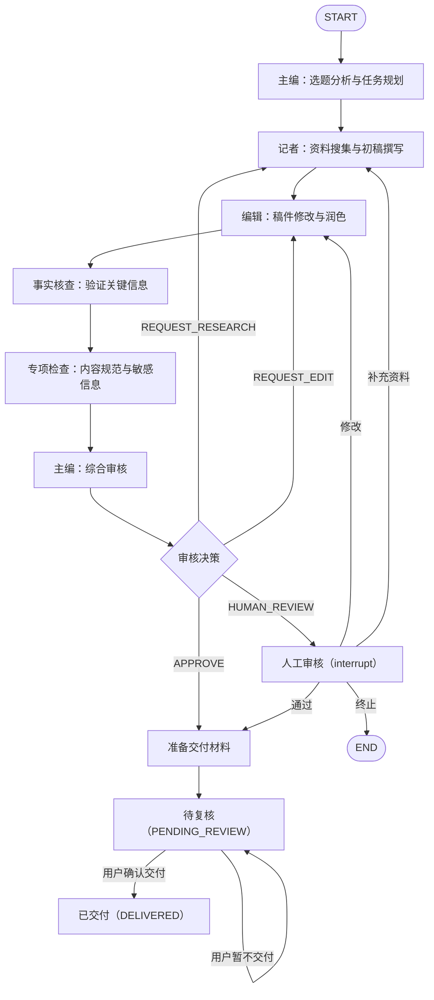
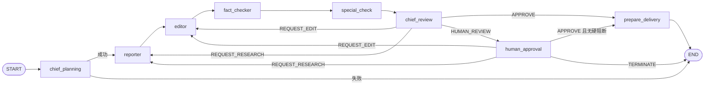

# AI Newsroom 智能新闻编辑部 — 工作流设计文档（Workflow Design）

| 项目 | 内容 |
| --- | --- |
| 文档编号 | NR-WF-001 |
| 文档版本 | V0.3 |
| 工作流框架 | LangGraph |
| 日期 | 2026-11-22 |
| 状态 | 已按分工文档调整为「专项检查 + 预发布准备」链（第 4 周） |
| 关联文档 | [Agent 设计](../03-agent-design/agent-specification.md)、[状态设计](../05-data-design/state-schema.md)、[API 规范](../06-api/api-specification.md) |

> **关键原则**：Agent 的执行顺序与 Agent 的决策权不是一回事。
> 记者完成后进入编辑，编辑完成后进入事实核查；事实核查之后还要经过专项检查，再回到主编决策。
> 系统**不对外发布**：审核通过后只准备交付材料并进入「待复核」，由用户自行复核、导出和提交。

---

## 1. 工作流设计目标

系统采用 LangGraph 构建多智能体协作工作流，将新闻采编任务拆分为多个独立执行节点，通过节点之间的连接关系和条件路由实现任务调度。

工作流需要支持：

- 正常顺序执行；
- 条件判断；
- 任务退回；
- 循环修改；
- 异常处理；
- 人工审核；
- 中断恢复。

系统不采用完全自由的 Agent 对话模式，而是由**主编 Agent 进行业务决策**，由 **LangGraph 负责实际的节点调度和状态流转**。

---

## 2. 工作流总体结构

| 节点名称 | 对应组件 | 主要职责 |
| --- | --- | --- |
| `START` | 系统入口 | 接收新闻任务 |
| `chief_planning` | 主编 Agent | 选题分析和采编计划 |
| `reporter` | 记者 Agent | 搜集资料和撰写初稿 |
| `editor` | 编辑 Agent | 修改和优化稿件 |
| `fact_checker` | 事实核查 Agent | 核实新闻事实 |
| `special_check` | 专项检查 Agent | 内容规范与敏感信息检查（当前为确定性桩） |
| `chief_review` | 主编 Agent | 综合核查、专项检查与稿件质量作出决策 |
| `human_approval` | 人工审核节点 | 主编转人工时以 `interrupt()` 暂停 |
| `prepare_delivery` | 预发布准备 Agent | 组装交付材料包（稿件、核查报告、专项检查、来源） |
| `END` | 系统结束 | 进入待复核 / 已交付 / 失败 / 终止 |



---

## 3. 节点详细设计

### 3.1 主编规划节点（`chief_planning`）

- **输入**：用户提交的新闻选题、背景描述、报道要求、目标篇幅、风格。
- **处理**：调用主编 Agent 分析选题，生成结构化采编计划，写入 `NewsTaskState.editorial_plan`。
- **输出**：报道角度、资料搜集任务、文章结构建议、重点核查信息。
- **下一步**：`reporter`。
- **状态**：`PLANNING → RESEARCHING`。

### 3.2 记者节点（`reporter`）

- **输入**：采编计划；若为重新执行，额外读取 `revision_request`（补充资料要求）。
- **处理**：调用搜索工具搜集资料，整理来源，撰写新闻初稿。
- **输出**：`draft_article`、`research_sources`、`research_summary`、`unverified_claims`。
- **下一步**：`editor`。
- **状态**：`RESEARCHING → WRITING → EDITING`（节点内阶段用 `current_stage` 区分）。

### 3.3 编辑节点（`editor`）

- **输入**：新闻初稿、采编要求；若为重新执行，额外读取主编意见或核查报告中的修改要求。
- **处理**：检查结构、优化标题与表达、控制篇幅，生成编辑稿与编辑说明。
- **输出**：`edited_article`、`editing_report`、新稿件版本。
- **下一步**：`fact_checker`。
- **状态**：`EDITING`。

### 3.4 事实核查节点（`fact_checker`）

- **输入**：编辑后的稿件及记者提供的资料来源。
- **处理**：抽取事实声明，调用搜索工具核实，生成结构化核查报告。
- **输出**：`fact_check_report`（含 `overall_result`、`claims`、`issues`、`recommendation`）。
- **下一步**：`special_check`。
- **状态**：`RUNNING`，阶段 `fact_check → special_check`。
- **重要**：核查结果**不直接决定后续节点**，只作为专项检查和主编决策的依据。

### 3.5 专项检查节点（`special_check`）

- **输入**：编辑稿、版本号、事实核查报告、来源列表。
- **处理**：检查内容规范、敏感信息、隐私与合规风险。当前实现为确定性桩（`SpecialCheckAgent`），固定返回 `PASSED`；D 模块接入真实规则引擎后替换实现。
- **输出**：`special_check_report`（`result ∈ PASSED / WARNING / BLOCKED`，`issues` 含 `INFO / WARNING / BLOCKING`）。
- **下一步**：`chief_review`。
- **状态**：`RUNNING`，阶段 `special_check → chief_review`。

### 3.6 主编审核节点（`chief_review`）

- **输入**：
  - 原始新闻选题、采编计划、资料来源；
  - 当前编辑后的稿件（版本号）；
  - 绑定了同一 `article_id + article_version` 的事实核查报告与专项检查报告；
  - 当前修改轮次 `revision_round` 与上限 `max_revision_rounds`。
- **处理**：主编 Agent 综合判断，返回明确审核决策；代码层再执行安全约束。
- **输出**：`chief_decision`、`review_comments`、`revision_request`（退回时）。
- **状态**：`RUNNING`（阶段 `revision_required` 或 `prepare_delivery`）或 `HUMAN_REVIEW`。

四种决策：

| 决策 | 含义 | 后续节点 |
| --- | --- | --- |
| `APPROVE` | 事实核查与专项检查均无阻断，稿件符合要求 | `prepare_delivery` |
| `REQUEST_EDIT` | 表达、结构或风格问题 | `editor` |
| `REQUEST_RESEARCH` | 事实错误、资料不足或来源不可靠 | `reporter` |
| `HUMAN_REVIEW` | 存在争议、无法判断，或修改轮次已达上限 | `human_approval` |

代码层安全约束（不依赖模型自觉）：

1. 事实核查不为 `PASSED` 时，`APPROVE` 降级为 `HUMAN_REVIEW`；
2. 专项检查为 `BLOCKED` 时，`APPROVE` 降级为 `HUMAN_REVIEW`；
3. 专项检查为 `WARNING` 时保留 `APPROVE`，但在审核意见中提示人工复核；
4. `revision_round >= max_revision_rounds` 时，任何退回决策强制转为 `HUMAN_REVIEW`。

### 3.7 人工审核节点（`human_approval`）

- **触发**：主编决策为 `HUMAN_REVIEW`。
- **处理**：工作流以 `interrupt()` 暂停，等待人工决定（通过 / 修改 / 补充资料 / 终止）。
- **路由**：通过 → `prepare_delivery`；修改 → `editor`；补充资料 → `reporter`；终止 → `END`。
- **状态**：`HUMAN_REVIEW`；终止后为 `TERMINATED`。
- **约束**：人工通过不能覆盖硬阻断。若事实核查为 `FAILED` 或专项检查为 `BLOCKED`，系统拒绝进入交付准备，任务保持 `HUMAN_REVIEW` 并在审核意见中说明原因。

### 3.8 预发布准备节点（`prepare_delivery`）

- **前置条件**：主编或人工审核通过；事实核查不为 `FAILED`；专项检查不为 `BLOCKED`；两份报告均绑定当前稿件版本。
- **处理**：组装 `DeliveryPackage`，包含任务、稿件版本、事实核查报告编号、专项检查报告编号、来源编号与准备时间。当前为确定性实现，不调用外部接口。
- **输出**：`delivery_package`；任务状态 `PENDING_REVIEW`，阶段 `pending_review`。
- **后续**：用户复核后可导出并自行提交；系统不执行对外发布。用户确认交付后任务进入 `DELIVERED`，确认动作由执行服务 / 演示接口完成，不在图内。

---

## 4. 条件路由设计

系统采用 LangGraph 条件边实现动态流程控制。

### 4.1 主编审核后的路由

```python
def route_after_review(state: NewsTaskState) -> str:
    decision = state.chief_decision

    if decision == ChiefDecision.APPROVE:
        return "prepare_delivery"
    if decision == ChiefDecision.REQUEST_EDIT:
        return "editor"
    if decision == ChiefDecision.REQUEST_RESEARCH:
        return "reporter"
    if decision == ChiefDecision.HUMAN_REVIEW:
        return "human_approval"
    return END
```

> 实际开发中通过 Pydantic 对决策字段校验，避免大模型返回无法识别的决策值。

### 4.2 人工审核后的路由

```python
def route_after_human_approval(state: NewsTaskState) -> str:
    if state.human_decision == HumanDecision.APPROVE:
        # 硬阻断（核查 FAILED / 专项检查 BLOCKED）时节点保持 HUMAN_REVIEW，直接结束
        return "prepare_delivery" if state.task_status == TaskStatus.RUNNING else END
    if state.human_decision == HumanDecision.REQUEST_EDIT:
        return "editor"
    if state.human_decision == HumanDecision.REQUEST_RESEARCH:
        return "reporter"
    return END
```

### 4.3 交付确认

`PENDING_REVIEW` 是图执行结束后的静止状态，不再通过 `interrupt()` 恢复图。用户确认交付（`DELIVERED`）或终止（`TERMINATED`）由执行服务更新状态并写入事件，属于 C-05 的执行接口职责。

### 4.4 修改轮次与上限

- 每次 `REQUEST_EDIT` / `REQUEST_RESEARCH` 使 `revision_round += 1`（主编退回和人工退回都计数）；
- `revision_round >= max_revision_rounds` 后，主编的退回决策由代码强制转为 `HUMAN_REVIEW`；
- 修改轮次与接口失败重试分开记录：`revision_round` 表示稿件修改轮次，`interface_retry_counts` 表示外部接口失败重试次数，二者不能混用；
- 任何稿件修改后必须**重新执行事实核查和专项检查**，报告必须绑定新版本；
- 所有退回必须携带结构化 `revision_request`，不得只有自然语言描述。

---

## 5. 工作流状态流转

任务状态（`task_status`）只保留六个业务状态，执行阶段由 `current_stage` 单独表达：

| 当前状态 | 触发事件 | 下一状态 |
| --- | --- | --- |
| `CREATED` | 用户创建任务 | `RUNNING`（阶段 `chief_planning`） |
| `RUNNING` | 任一流水线节点完成 | `RUNNING`（阶段推进） |
| `RUNNING` | 主编转人工 | `HUMAN_REVIEW` |
| `RUNNING` | 交付材料准备完成 | `PENDING_REVIEW` |
| `HUMAN_REVIEW` | 人工通过且无硬阻断 | `RUNNING → PENDING_REVIEW` |
| `HUMAN_REVIEW` | 人工要求修改 / 补充资料 | `RUNNING`（阶段 `revision_required`） |
| `HUMAN_REVIEW` | 人工终止 | `TERMINATED` |
| `PENDING_REVIEW` | 用户确认交付 | `DELIVERED` |
| `PENDING_REVIEW` | 用户终止 | `TERMINATED` |
| 任意执行状态 | 不可恢复异常 | `FAILED` |
| 任意未完成状态 | 用户终止 | `TERMINATED` |

> 阶段取值见 `WorkflowStage`：`created / chief_planning / research / editing / fact_check / special_check / chief_review / revision_required / human_review / prepare_delivery / pending_review / delivered / error / terminated`。
> 状态流转由工作流代码统一控制，**不能完全依赖大语言模型自行修改**。

---

## 6. 异常处理机制

系统主要处理三类异常。

### 6.1 模型调用异常

例如 API 超时、请求失败和速率限制。系统应进行有限次数重试；超过重试次数后停止推进并记录错误信息。

- 单次调用：LLM 与搜索接口对可重试错误最多重试 1 次；
- 任务预算：每个任务的每个接口另有独立预算 `Settings.max_interface_retries`（默认 2），由 `InterfaceRetryTracker` 在节点执行期间累计并写入 `interface_retry_counts`；
- 预算耗尽：接口仍失败时不再重试，节点失败，任务置 `FAILED` 并记录 `INTERFACE_RETRY_EXCEEDED`（搜索统一为 `SEARCH_FAILED`）；
- 该计数与稿件修改轮次 `revision_round` 完全独立，不共享上限。

### 6.2 工具调用异常

例如搜索接口不可用、网页获取失败和返回数据异常。系统应记录错误原因，并根据任务情况决定重新搜索或要求用户补充资料。

### 6.3 业务执行异常

例如 Agent 返回格式错误、缺少必要字段和审核决策无法识别。系统应通过结构化数据校验和错误路由机制阻止异常结果进入下一节点。

### 6.4 暂停与恢复

- 使用 LangGraph Checkpointer 保存每个节点执行后的状态，`thread_id = task_id`；
- 执行服务采用**后台任务模式**：`execute` / `human-review` / `resume` 校验通过后返回 `202` 与最新 `TaskDetail`，同时在进程内启动 `asyncio.Task`，把图运行到下一个暂停点（人工审核、待复核、失败或终止）；前端轮询 `GET /tasks/{id}` 观察进度；
- 后台任务每个 `stream_mode="values"` 分块都落一次状态（指纹变化时才写），进程内异常统一落 `FAILED / RUNTIME_ERROR`，任务不会悬挂在 `RUNNING`；
- 执行期间持有任务级执行锁（默认 900 秒 TTL），并发启动返回 `2003`；人工决策 / 恢复接口会先等待正在收尾的任务退出（最多 5 秒），再判定锁占用；
- 停在 `human_approval` 阶段的任务，必须通过人工接口恢复；恢复前校验检查点存在待处理的中断；
- `PENDING_REVIEW` 阶段不再恢复图，由执行服务更新交付 / 终止状态；
- 暂停采用**节点边界生效**：`pause` 只置暂停标记，正在运行的任务在下一个节点边界停止，状态保存为 `RUNNING + paused`；`resume` 从检查点续跑（`payload=None`），暂停尚未生效时返回 `2003` 提示重试；
- 任务失败或服务重启后的检查点恢复仍待 C-06 实现；`MemorySaver` 不跨进程保留；
- 恢复时不得重复执行已完成节点（幂等：来源按 URL 去重、稿件版本按 `(article_id, version)` 唯一）。

---

## 7. 人工介入机制

系统在以下场景允许人工介入：

- 主编无法判断新闻内容是否符合报道要求。
- 事实核查结果存在较大争议。
- 新闻资料缺少可靠来源。
- 系统达到修改轮次上限，需要人工接手。
- 用户需要修改或终止新闻采编任务。
- 交付材料准备完成后，用户需要复核并自行导出、提交。

> 人工介入应作为工作流中的**正式节点或中断点**，而不是简单地在 Agent 提示词中要求模型等待。

人工审核节点使用 `interrupt()` 实现：

```python
from langgraph.types import interrupt

def human_approval_node(state: NewsTaskState) -> dict:
    decision = interrupt({
        "task_id": state["task_id"],
        "article": state["edited_article"],
        "fact_check_report": state["fact_check_report"],
        "chief_decision": state["chief_decision"],
        "review_comments": state.get("review_comments"),
    })
    return {"human_decision": decision["decision"],
            "review_comments": decision.get("comments")}
```

恢复时通过 `Command(resume=...)` 传入人工决定。

---

## 8. 工作流实现约束

1. 每个业务节点应具有独立的输入输出结构。
2. 各节点通过共享状态传递信息。
3. 主编负责业务决策，LangGraph 负责流程调度。
4. 修改稿件后应重新执行事实核查和专项检查，报告必须绑定当前版本。
5. 修改轮次达到上限后应转入人工处理。
6. 交付准备必须校验主编 / 人工审核结论、核查结果、专项检查结果与报告版本绑定；系统不执行对外发布。
7. 对重要节点的执行结果和状态变化进行持久化记录。
8. 图编译时设置 `recursion_limit`（建议 50）作为循环保护。

---

## 9. 图编译参考（当前实现）

```python
builder = StateGraph(NewsTaskState)

builder.add_node("chief_planning", chief_planning_node)
builder.add_node("reporter", reporter_node)
builder.add_node("editor", editor_node)
builder.add_node("fact_checker", fact_checker_node)
builder.add_node("special_check", special_check_node)
builder.add_node("chief_review", chief_review_node)
builder.add_node("human_approval", human_approval_node)
builder.add_node("prepare_delivery", prepare_delivery_node)

builder.add_edge(START, "chief_planning")
builder.add_edge("chief_planning", "reporter")
builder.add_edge("reporter", "editor")
builder.add_edge("editor", "fact_checker")
builder.add_edge("fact_checker", "special_check")
builder.add_edge("special_check", "chief_review")
builder.add_conditional_edges("chief_review", route_after_review, {
    "prepare_delivery": "prepare_delivery",
    "editor": "editor",
    "reporter": "reporter",
    "human_approval": "human_approval",
})
builder.add_conditional_edges("human_approval", route_after_human_approval, {
    "prepare_delivery": "prepare_delivery",
    "editor": "editor",
    "reporter": "reporter",
    "end": END,
})
builder.add_edge("prepare_delivery", END)

graph = builder.compile(checkpointer=checkpointer)
```

当前实现使用条件边处理各节点失败（`task_status=FAILED` 时直接 `END`），并用 `recursion_limit=50` 作为循环保护。`PENDING_REVIEW` 之后不再有图内节点。

---

## 10. 实现记录

### 10.1 实现位置

| 内容 | 位置 |
| --- | --- |
| 条件路由 | `backend/app/graph/routing.py` |
| 节点实现 | `backend/app/graph/nodes.py` |
| 图组装与运行封装 | `backend/app/graph/workflow.py` |
| 主编 / 专项检查 / 交付准备 | `backend/app/agents/chief_editor.py`、`special_check.py`、`delivery.py` |
| 发布 Agent（B/D 交接保留） | `backend/app/agents/publisher.py`、`backend/app/services/publish_service.py` |

### 10.2 实际图结构



### 10.3 关键实现说明

1. **专项检查在核查之后、主编之前**：`fact_checker` 完成即进入 `special_check`；专项检查报告绑定 `task_id + article_id + article_version`。
2. **交付准备代替发布链**：`prepare_delivery` 生成 `DeliveryPackage`，任务进入 `PENDING_REVIEW`；系统不调用外部发布接口。
3. **人工审核恢复值**：`{"decision": "...", "comments": "...", "revision_reason": "...", "revision_requirements": [...]}`，退回时校验原因与要求非空。
4. **人工不能覆盖硬阻断**：核查 `FAILED` 或专项检查 `BLOCKED` 时，人工通过仍保持 `HUMAN_REVIEW` 并写入说明。
5. **失败即终止**：任一 Agent 返回 `FAILED` 时，节点写入 `error`、`task_status=FAILED`、`current_stage=error`，路由直接到 `END`。
6. **检查点**：使用 LangGraph `MemorySaver`，`thread_id = task_id`；进程重启后不保留，持久化 Checkpointer 仍待接入。
7. **双重循环保护**：图编译设置 `recursion_limit=50`；`revision_round` 达到 `max_revision_rounds` 时，主编节点把退回决策强制转为人审。
8. **执行日志**：每个节点追加一条 `execution_logs`，记录 Agent、状态、起止时间、输出摘要或错误；数据库存储按 `task_id + seq` 增量同步。

### 10.4 运行方式

```python
from app.graph.state import NewsTaskState
from app.graph.workflow import NewsroomWorkflow

workflow = NewsroomWorkflow()
result = await workflow.run(NewsTaskState(task_id="TASK_001", topic="选题"))
# result.interrupt 非空表示停在人工审核；任务到达 PENDING_REVIEW 时图已结束
result = await workflow.resume("TASK_001", {"decision": "APPROVE", "comments": "通过"})
```

### 10.5 验证结果

- 2026-11-14（第 3 周）：自动化测试 120 项通过，真实 DeepSeek + Tavily 冒烟到达 `PUBLISHED`（旧发布链，已按分工文档废弃）。
- 2026-11-22（第 4 周）：全量测试 163 项通过；正常链路到达 `PENDING_REVIEW` 并生成交付材料包；修改轮次、硬阻断、人工终止、失败节点等分支均有覆盖。
- 2026-11-22（C-05）：执行服务与接口测试覆盖后台执行、暂停 / 恢复、人工批准 / 退回 / 终止、交付确认、执行事件、执行锁冲突与运行时异常落库。
- 2026-11-22（C-04）：条件分支（证据不足回记者、表述问题回编辑、争议转人工）已覆盖；接口失败重试按接口独立计数并以 `max_interface_retries` 设限，重试预算耗尽后任务失败，计数随任务详情返回。
- 尚未覆盖：进程重启恢复与重复启动防护（C-06）、真实专项检查规则、SSE 实时进度。

### 10.6 执行服务（C-05）

| 模块 | 位置 | 说明 |
| --- | --- | --- |
| 执行服务 | `backend/app/services/execution_service.py` | 后台任务调度、暂停 / 恢复、人工审核、交付确认、事件查询；执行锁与失败落库 |
| 正式接口 | `backend/app/api/routes/tasks.py` | `execute / pause / resume / human-review / delivery / delivery/confirm / events` |
| 执行锁 TTL | `Settings.execution_lock_ttl_seconds` | 默认 900 秒，防止并发执行同一任务 |
| 检查点状态 | `NewsroomWorkflow.has_next_step / has_pending_interrupt` | 恢复前确认检查点可续跑、人工恢复确认存在待处理中断 |
| 后台作业 | `ExecutionJob` | 记录当前任务句柄、最新状态与暂停标记；运行结束或异常后释放并删除 |
| 接口重试预算 | `app/core/retries.py`、`Settings.max_interface_retries` | 节点级上下文累计 LLM / 搜索重试次数，预算耗尽后停止重试；计数写入 `interface_retry_counts` |

写接口统一返回最新 `TaskDetail`，便于前端一次拿到执行结果；异常约定：状态不允许 `2002`，执行锁占用 `2003`，参数错误 `1001`，任务不存在 `2001`。
