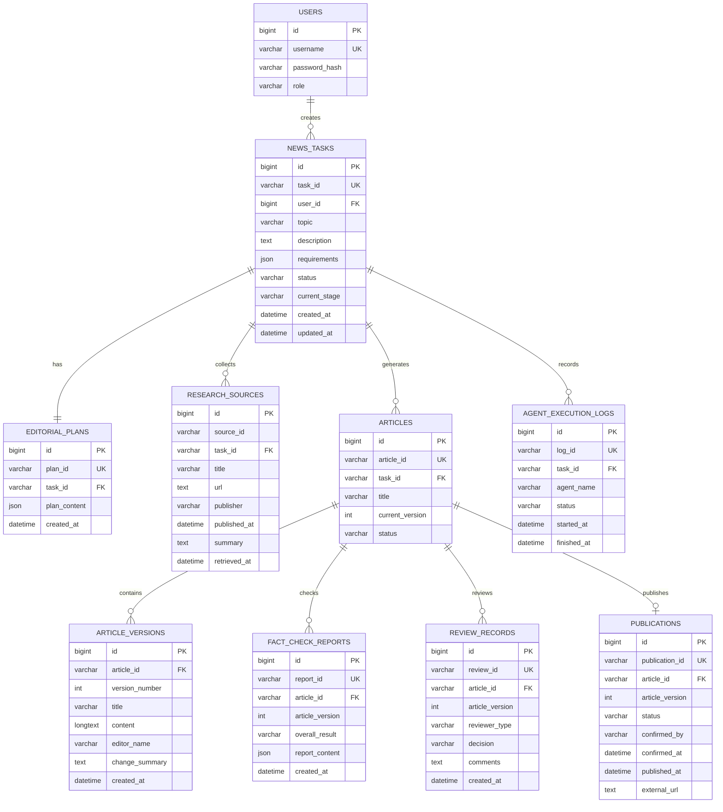

# AI Newsroom 智能新闻编辑部 — 数据库设计文档

| 项目 | 内容 |
| --- | --- |
| 文档编号 | NR-DB-001 |
| 文档版本 | V0.1 |
| 数据库 | MySQL 8.0，utf8mb4，InnoDB |
| 日期 | 2026-11-13 |
| 状态 | 基线文档 |
| 关联文档 | [状态设计](state-schema.md)、[工作流设计](../04-workflow/workflow-design.md)、[API 规范](../06-api/api-specification.md) |

---

## 1. 设计原则

1. **任务为中心**：业务数据统一挂在 `news_tasks` 下，便于查询与追溯；
2. **稿件只追加、不覆盖**：每次修改生成新的 `article_versions` 记录；
3. **核查与版本绑定**：核查报告必须关联具体稿件版本，避免「核查旧稿、发布新稿」；
4. **业务数据与工作流状态分离**：MySQL 保存业务数据，LangGraph Checkpointer 保存执行检查点；
5. **枚举用 VARCHAR**：状态、决策等枚举存字符串，应用层用 Pydantic / Python Enum 校验；
6. **审计可追溯**：审核、发布、Agent 执行均记录操作者与时间。

---

## 2. E-R 图



---

## 3. 表结构

### 3.1 `users` — 用户

```sql
CREATE TABLE users (
    id            BIGINT UNSIGNED AUTO_INCREMENT PRIMARY KEY,
    username      VARCHAR(64)  NOT NULL,
    password_hash VARCHAR(255) NOT NULL,
    display_name  VARCHAR(64)  NOT NULL,
    role          VARCHAR(32)  NOT NULL DEFAULT 'user',   -- user | admin
    is_active     TINYINT(1)   NOT NULL DEFAULT 1,
    created_at    DATETIME(3)  NOT NULL DEFAULT CURRENT_TIMESTAMP(3),
    updated_at    DATETIME(3)  NOT NULL DEFAULT CURRENT_TIMESTAMP(3)
                  ON UPDATE CURRENT_TIMESTAMP(3),
    UNIQUE KEY uk_users_username (username)
) ENGINE=InnoDB DEFAULT CHARSET=utf8mb4;
```

> 课程设计阶段以普通用户与系统管理员两类角色为主。

### 3.2 `news_tasks` — 新闻任务表

```sql
CREATE TABLE news_tasks (
    id            BIGINT UNSIGNED AUTO_INCREMENT PRIMARY KEY,
    task_id       VARCHAR(64)   NOT NULL,
    user_id       BIGINT UNSIGNED NOT NULL,
    topic         VARCHAR(500)  NOT NULL,
    description   TEXT          NULL,
    requirements  JSON          NULL,    -- style / target_length / focus
    status        VARCHAR(32)   NOT NULL,
    current_stage VARCHAR(32)   NULL,
    error_message TEXT          NULL,
    created_at    DATETIME(3)   NOT NULL DEFAULT CURRENT_TIMESTAMP(3),
    updated_at    DATETIME(3)   NOT NULL DEFAULT CURRENT_TIMESTAMP(3)
                  ON UPDATE CURRENT_TIMESTAMP(3),
    UNIQUE KEY uk_tasks_task_id (task_id),
    KEY idx_tasks_status_created (status, created_at),
    KEY idx_tasks_user (user_id),
    CONSTRAINT fk_tasks_user FOREIGN KEY (user_id) REFERENCES users(id)
) ENGINE=InnoDB DEFAULT CHARSET=utf8mb4;
```

### 3.3 `editorial_plans` — 采编计划表

```sql
CREATE TABLE editorial_plans (
    id           BIGINT UNSIGNED AUTO_INCREMENT PRIMARY KEY,
    plan_id      VARCHAR(64) NOT NULL,
    task_id      VARCHAR(64) NOT NULL,
    plan_content JSON        NOT NULL,   -- topic_analysis / reporting_angles / ...
    created_at   DATETIME(3) NOT NULL DEFAULT CURRENT_TIMESTAMP(3),
    UNIQUE KEY uk_plans_plan_id (plan_id),
    KEY idx_plans_task (task_id),
    CONSTRAINT fk_plans_task FOREIGN KEY (task_id)
        REFERENCES news_tasks(task_id) ON DELETE CASCADE
) ENGINE=InnoDB DEFAULT CHARSET=utf8mb4;
```

### 3.4 `research_sources` — 新闻资料表

```sql
CREATE TABLE research_sources (
    id           BIGINT UNSIGNED AUTO_INCREMENT PRIMARY KEY,
    source_id    VARCHAR(64)  NOT NULL,   -- 任务内编号 SRC_001
    task_id      VARCHAR(64)  NOT NULL,
    title        VARCHAR(500) NOT NULL,
    url          TEXT         NOT NULL,
    publisher    VARCHAR(255) NULL,
    published_at DATETIME(3)  NULL,
    summary      TEXT         NULL,
    retrieved_at DATETIME(3)  NOT NULL DEFAULT CURRENT_TIMESTAMP(3),
    UNIQUE KEY uk_sources_task_source (task_id, source_id),
    KEY idx_sources_task (task_id),
    CONSTRAINT fk_sources_task FOREIGN KEY (task_id)
        REFERENCES news_tasks(task_id) ON DELETE CASCADE
) ENGINE=InnoDB DEFAULT CHARSET=utf8mb4;
```

> 应用层对 URL 做归一化并去重（同一任务内同一 URL 只保留一条）。

### 3.5 `articles` — 新闻稿件表

```sql
CREATE TABLE articles (
    id              BIGINT UNSIGNED AUTO_INCREMENT PRIMARY KEY,
    article_id      VARCHAR(64)  NOT NULL,
    task_id         VARCHAR(64)  NOT NULL,
    title           VARCHAR(500) NOT NULL,
    current_version INT          NOT NULL DEFAULT 1,
    status          VARCHAR(32)  NOT NULL,
    created_at      DATETIME(3)  NOT NULL DEFAULT CURRENT_TIMESTAMP(3),
    updated_at      DATETIME(3)  NOT NULL DEFAULT CURRENT_TIMESTAMP(3)
                    ON UPDATE CURRENT_TIMESTAMP(3),
    UNIQUE KEY uk_articles_article_id (article_id),
    UNIQUE KEY uk_articles_task (task_id),      -- 一个任务一篇稿件
    CONSTRAINT fk_articles_task FOREIGN KEY (task_id)
        REFERENCES news_tasks(task_id) ON DELETE CASCADE
) ENGINE=InnoDB DEFAULT CHARSET=utf8mb4;
```

### 3.6 `article_versions` — 稿件版本表

```sql
CREATE TABLE article_versions (
    id             BIGINT UNSIGNED AUTO_INCREMENT PRIMARY KEY,
    article_id     VARCHAR(64)  NOT NULL,
    version_number INT          NOT NULL,
    title          VARCHAR(500) NOT NULL,
    content        LONGTEXT     NOT NULL,
    editor_name    VARCHAR(64)  NOT NULL,   -- reporter / editor / human
    change_summary TEXT         NULL,
    created_at     DATETIME(3)  NOT NULL DEFAULT CURRENT_TIMESTAMP(3),
    UNIQUE KEY uk_versions_article_version (article_id, version_number),
    KEY idx_versions_article (article_id),
    CONSTRAINT fk_versions_article FOREIGN KEY (article_id)
        REFERENCES articles(article_id) ON DELETE CASCADE
) ENGINE=InnoDB DEFAULT CHARSET=utf8mb4;
```

### 3.7 `fact_check_reports` — 事实核查报告表

```sql
CREATE TABLE fact_check_reports (
    id             BIGINT UNSIGNED AUTO_INCREMENT PRIMARY KEY,
    report_id      VARCHAR(64) NOT NULL,
    article_id     VARCHAR(64) NOT NULL,
    article_version INT        NOT NULL,    -- 必须绑定具体版本
    overall_result VARCHAR(32) NOT NULL,    -- PASSED | PARTIAL | FAILED
    report_content JSON        NOT NULL,    -- claims / evidence / issues / recommendation
    created_at     DATETIME(3) NOT NULL DEFAULT CURRENT_TIMESTAMP(3),
    UNIQUE KEY uk_fcr_report_id (report_id),
    KEY idx_fcr_article_version (article_id, article_version),
    CONSTRAINT fk_fcr_article FOREIGN KEY (article_id)
        REFERENCES articles(article_id) ON DELETE CASCADE
) ENGINE=InnoDB DEFAULT CHARSET=utf8mb4;
```

### 3.8 `review_records` — 审核记录表

```sql
CREATE TABLE review_records (
    id              BIGINT UNSIGNED AUTO_INCREMENT PRIMARY KEY,
    review_id       VARCHAR(64) NOT NULL,
    article_id      VARCHAR(64) NOT NULL,
    article_version INT         NOT NULL,
    reviewer_type   VARCHAR(16) NOT NULL,   -- chief | human
    reviewer_id     BIGINT UNSIGNED NULL,
    decision        VARCHAR(32) NOT NULL,   -- APPROVE | REQUEST_EDIT | REQUEST_RESEARCH | HUMAN_REVIEW | TERMINATE
    comments        TEXT        NULL,
    created_at      DATETIME(3) NOT NULL DEFAULT CURRENT_TIMESTAMP(3),
    UNIQUE KEY uk_reviews_review_id (review_id),
    KEY idx_reviews_article (article_id, created_at),
    CONSTRAINT fk_reviews_article FOREIGN KEY (article_id)
        REFERENCES articles(article_id) ON DELETE CASCADE
) ENGINE=InnoDB DEFAULT CHARSET=utf8mb4;
```

### 3.9 `agent_execution_logs` — Agent 执行日志表

```sql
CREATE TABLE agent_execution_logs (
    id             BIGINT UNSIGNED AUTO_INCREMENT PRIMARY KEY,
    log_id         VARCHAR(64) NOT NULL,
    task_id        VARCHAR(64) NOT NULL,
    agent_name     VARCHAR(64) NOT NULL,   -- chief_editor / reporter / editor / fact_checker / publisher
    status         VARCHAR(32) NOT NULL,   -- PENDING | RUNNING | COMPLETED | FAILED
    input_summary  TEXT        NULL,
    output_summary TEXT        NULL,
    error_message  TEXT        NULL,
    started_at     DATETIME(3) NULL,
    finished_at    DATETIME(3) NULL,
    UNIQUE KEY uk_logs_log_id (log_id),
    KEY idx_logs_task_time (task_id, started_at),
    CONSTRAINT fk_logs_task FOREIGN KEY (task_id)
        REFERENCES news_tasks(task_id) ON DELETE CASCADE
) ENGINE=InnoDB DEFAULT CHARSET=utf8mb4;
```

### 3.10 `publications` — 发布记录表

```sql
CREATE TABLE publications (
    id              BIGINT UNSIGNED AUTO_INCREMENT PRIMARY KEY,
    publication_id  VARCHAR(64) NOT NULL,
    article_id      VARCHAR(64) NOT NULL,
    article_version INT         NOT NULL,
    status          VARCHAR(32) NOT NULL,  -- PENDING_PUBLISH | PUBLISHED | FAILED
    confirmed_by    VARCHAR(64) NULL,
    confirmed_at    DATETIME(3) NULL,
    published_at    DATETIME(3) NULL,
    external_url    TEXT        NULL,
    error_message   TEXT        NULL,
    created_at      DATETIME(3) NOT NULL DEFAULT CURRENT_TIMESTAMP(3),
    UNIQUE KEY uk_publications_id (publication_id),
    UNIQUE KEY uk_publications_article_version (article_id, article_version),
    KEY idx_publications_status (status),
    CONSTRAINT fk_publications_article FOREIGN KEY (article_id)
        REFERENCES articles(article_id) ON DELETE CASCADE
) ENGINE=InnoDB DEFAULT CHARSET=utf8mb4;
```

> 唯一键 `(article_id, article_version)` 保证同一稿件版本只产生一条发布记录，重复确认时幂等返回。

---

## 4. 状态与枚举

| 字段 | 取值 |
| --- | --- |
| `news_tasks.status` | `CREATED, PLANNING, RESEARCHING, WRITING, EDITING, FACT_CHECKING, REVIEWING, HUMAN_REVIEW, PENDING_PUBLISH, PUBLISHED, REVISION_REQUIRED, FAILED, CANCELLED` |
| `review_records.decision` | `APPROVE, REQUEST_EDIT, REQUEST_RESEARCH, HUMAN_REVIEW, TERMINATE` |
| `fact_check_reports.overall_result` | `PASSED, PARTIAL, FAILED` |
| `agent_execution_logs.status` | `PENDING, RUNNING, COMPLETED, FAILED` |
| `publications.status` | `PENDING_PUBLISH, PUBLISHED, FAILED` |
| `article_versions.editor_name` | `reporter, editor, human` |

> 应用层使用 Python Enum / Pydantic 校验；数据库保留 VARCHAR 便于演进。

---

## 5. 索引与主要查询

| 查询场景 | 使用索引 |
| --- | --- |
| 任务列表（按状态、时间） | `idx_tasks_status_created` |
| 用户任务列表 | `idx_tasks_user` |
| 任务稿件版本 | `uk_versions_article_version` |
| 核查报告（按稿件版本） | `idx_fcr_article_version` |
| 审核记录（按稿件时间） | `idx_reviews_article` |
| Agent 执行日志 | `idx_logs_task_time` |
| 发布记录状态 | `idx_publications_status` |

---

## 6. 事务与一致性

| 操作 | 事务边界 |
| --- | --- |
| 创建任务 | `news_tasks` + 首条 `agent_execution_logs`（可选）同事务 |
| 保存采编计划 | `editorial_plans` 插入 |
| 保存稿件版本 | `article_versions` 插入 + `articles.current_version` 更新同事务 |
| 保存核查报告 | `fact_check_reports` 插入（绑定 `article_version`） |
| 审核记录 | `review_records` 插入 + `news_tasks.status` 更新同事务 |
| 用户确认发布 | `publications.confirmed_*` 更新 + 发布结果写入 |

> 外部 LLM / 搜索调用不在数据库事务内执行；先完成调用再落库，避免长事务。

---

## 7. 业务数据与工作流状态的分工

| 数据 | 存储 | 说明 |
| --- | --- | --- |
| 任务、计划、来源、稿件版本、核查报告、审核、发布 | MySQL 业务表 | 长期保存与查询 |
| LangGraph 共享状态与检查点 | Checkpointer（`thread_id = task_id`） | 支持暂停、恢复、人工中断 |
| Agent 执行日志 | `agent_execution_logs` | 审计与问题排查 |

Checkpointer 表由 LangGraph 持久化实现创建，不在业务迁移中手工维护。

---

## 8. 数据保留与清理

- 业务数据默认保留 ≥ 12 个月；
- `agent_execution_logs` 可按月归档；
- 删除任务时级联删除计划、来源、稿件版本、核查报告、审核记录、执行日志和发布记录（仅管理员操作）；
- 任务完成 30 天后可清理对应 LangGraph 检查点。
