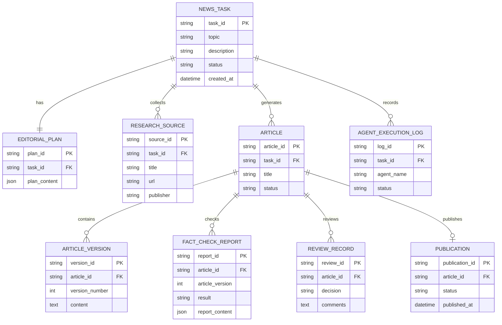

# AI Newsroom 智能新闻编辑部 — 数据模型与工作流状态设计文档

| 项目 | 内容 |
| --- | --- |
| 文档编号 | NR-STATE-001 |
| 文档版本 | V0.1 |
| 数据库 | MySQL |
| 状态管理 | LangGraph State |
| 数据校验 | Pydantic |
| 日期 | 2026-11-13 |
| 状态 | 基线文档 |
| 关联文档 | [数据库设计](database-design.md)、[工作流设计](../04-workflow/workflow-design.md)、[Agent 设计](../03-agent-design/agent-specification.md) |

---

## 1. 设计目标

数据设计主要解决三个问题：

1. 如何统一保存新闻采编任务的完整信息；
2. 如何让不同 Agent 在执行过程中共享必要的数据；
3. 如何持久化任务、稿件、资料来源和核查报告，以支持任务查询、历史追踪和工作流恢复。

系统采用 MySQL 作为主要业务数据库，使用 LangGraph State 作为工作流执行过程中的共享状态，并通过 Pydantic 定义数据结构和校验规则。

---

## 2. 核心数据实体

| 实体 | 说明 | 主要持久化表 |
| --- | --- | --- |
| NewsTask | 新闻采编任务 | `news_tasks` |
| EditorialPlan | 主编生成的采编计划 | `editorial_plans` |
| ResearchSource | 记者搜集的新闻资料来源 | `research_sources` |
| Article | 新闻稿件 | `articles` |
| ArticleVersion | 新闻稿件版本 | `article_versions` |
| FactCheckReport | 事实核查报告 | `fact_check_reports` |
| ReviewRecord | 主编 / 人工审核记录 | `review_records` |
| AgentExecutionLog | Agent 执行日志 | `agent_execution_logs` |
| Publication | 新闻发布记录 | `publications` |

主要关系：



---

## 3. LangGraph 共享状态设计

### 3.1 设计原则

- 五个 Agent **不直接相互调用**，而是通过读取和更新统一状态实现信息交互；
- 每个 Agent 只更新自身任务对应的业务结果；
- 主编 Agent 负责生成审核决策和下一步业务要求；
- LangGraph 负责节点之间的状态流转；
- 系统服务层负责任务状态持久化；
- 重要状态变化需要记录日志。

例如：记者 Agent 完成工作后，只更新 `research_sources`、`research_summary` 和 `draft_article` 等字段，不直接修改 `chief_decision`。

### 3.2 NewsTaskState 字段

| 字段 | 类型 | 说明 | 写入方 |
| --- | --- | --- | --- |
| `task_id` | str | 新闻任务编号 | 创建任务 |
| `topic` | str | 新闻选题 | 创建任务 |
| `description` | str | 选题背景描述 | 创建任务 |
| `requirements` | dict | 用户需求（风格、篇幅、重点方向） | 创建任务 |
| `editorial_plan` | dict | 主编采编计划 | 主编 |
| `research_sources` | list | 新闻资料来源 | 记者 |
| `research_summary` | str | 资料搜集总结 | 记者 |
| `draft_article` | dict | 记者初稿 | 记者 |
| `edited_article` | dict | 编辑后的稿件 | 编辑 |
| `fact_check_report` | dict | 事实核查报告 | 事实核查 |
| `chief_decision` | str | 主编审核决策 | 主编 |
| `review_comments` | str | 审核意见 | 主编 / 人工 |
| `revision_request` | dict | 修改或补充资料要求 | 主编 / 人工 |
| `current_stage` | str | 当前执行阶段（节点内阶段） | 工作流 |
| `task_status` | str | 当前任务状态 | 工作流 |
| `retry_count` | int | 重试或退回计数 | 工作流 |
| `user_confirmation` | bool | 用户是否确认发布 | 用户接口 |
| `human_decision` | str \| None | 人工审核决定 | 人工接口 |
| `execution_logs` | list | 执行记录 | 各节点 |
| `publication` | dict | 发布信息 | 审核发布 |
| `error` | dict \| None | 错误信息 | 工作流 |

### 3.3 TypedDict 定义

```python
from typing import TypedDict, Optional


class NewsTaskState(TypedDict, total=False):
    # 基础任务信息
    task_id: str
    topic: str
    description: str
    requirements: dict

    # 主编规划结果
    editorial_plan: dict

    # 记者工作结果
    research_sources: list
    research_summary: str
    draft_article: dict

    # 编辑结果
    edited_article: dict

    # 事实核查结果
    fact_check_report: dict

    # 主编审核结果
    chief_decision: str
    review_comments: str

    # 退回修改信息
    revision_request: dict

    # 工作流管理
    current_stage: str
    task_status: str
    retry_count: int

    # 人工与发布
    user_confirmation: bool
    human_decision: Optional[str]
    publication: dict

    # 执行记录
    execution_logs: list

    # 异常信息
    error: Optional[dict]
```

> 实际项目中，应对 `editorial_plan`、`draft_article`、`edited_article`、`fact_check_report` 等字段建立独立的 Pydantic `BaseModel`，避免使用过多未经约束的字典。

### 3.4 Pydantic 模型（建议）

```python
from datetime import datetime
from typing import Literal
from pydantic import BaseModel, Field


class EditorialPlan(BaseModel):
    topic_analysis: str
    reporting_angles: list[str] = Field(min_length=1)
    research_tasks: list[str] = Field(min_length=1)
    article_outline: list[str] = Field(min_length=1)
    verification_points: list[str] = Field(min_length=1)


class ResearchSource(BaseModel):
    source_id: str
    title: str
    url: str
    publisher: str | None = None
    published_at: datetime | None = None
    summary: str | None = None


class DraftArticle(BaseModel):
    title: str
    content: str


class EditedArticle(BaseModel):
    title: str
    content: str


class VerificationClaim(BaseModel):
    claim: str
    result: Literal["VERIFIED", "CONTRADICTED", "UNVERIFIED", "PARTIALLY_VERIFIED"]
    evidence: list[dict] = []
    reason: str


class VerificationReport(BaseModel):
    overall_result: Literal["PASSED", "PARTIAL", "FAILED"]
    claims: list[VerificationClaim]
    issues: list[str] = []
    recommendation: Literal["APPROVE", "REQUEST_EDIT", "REQUEST_RESEARCH", "HUMAN_REVIEW"] | None = None


class RevisionRequest(BaseModel):
    target: Literal["reporter", "editor"]
    reason: str
    requirements: list[str]
    related_claims: list[str] = []


class Publication(BaseModel):
    status: Literal["PENDING_PUBLISH", "PUBLISHED", "FAILED"]
    article_id: str
    published_at: datetime | None = None
    external_url: str | None = None
    message: str | None = None
```

---

## 4. 状态枚举设计

### 4.1 任务状态

```python
class TaskStatus:
    CREATED = "CREATED"
    PLANNING = "PLANNING"
    RESEARCHING = "RESEARCHING"
    WRITING = "WRITING"
    EDITING = "EDITING"
    FACT_CHECKING = "FACT_CHECKING"
    REVIEWING = "REVIEWING"
    HUMAN_REVIEW = "HUMAN_REVIEW"
    PENDING_PUBLISH = "PENDING_PUBLISH"
    PUBLISHED = "PUBLISHED"
    REVISION_REQUIRED = "REVISION_REQUIRED"
    FAILED = "FAILED"
    CANCELLED = "CANCELLED"
```

### 4.2 主编决策状态

```python
class ChiefDecision:
    APPROVE = "APPROVE"
    REQUEST_EDIT = "REQUEST_EDIT"
    REQUEST_RESEARCH = "REQUEST_RESEARCH"
    HUMAN_REVIEW = "HUMAN_REVIEW"
```

### 4.3 Agent 执行状态

```python
class AgentStatus:
    PENDING = "PENDING"
    RUNNING = "RUNNING"
    COMPLETED = "COMPLETED"
    FAILED = "FAILED"
```

### 4.4 事实核查状态

| 枚举 | 所属 | 取值 |
| --- | --- | --- |
| Claim 结果 | 单条断言 | `VERIFIED` / `CONTRADICTED` / `UNVERIFIED` / `PARTIALLY_VERIFIED` |
| 总体结果 | 报告级 | `PASSED` / `PARTIAL` / `FAILED` |
| 建议 | 报告级 | `APPROVE` / `REQUEST_EDIT` / `REQUEST_RESEARCH` / `HUMAN_REVIEW` |

---

## 5. 状态更新与转移规则

1. 每个 Agent 只负责更新自身任务对应的业务结果。
2. 主编负责生成审核决策和下一步业务要求。
3. LangGraph 负责节点之间的状态流转。
4. 系统服务层负责任务状态持久化。
5. 重要状态变化必须记录日志（`agent_execution_logs`）。
6. 状态流转由代码控制，不信任模型自行返回的状态值。
7. 修改稿件后，`fact_check_report` 必须重新生成并关联新的 `article_version`。

### 状态与数据库同步

| 工作流位置 | `news_tasks.status` | `current_stage` 示例 |
| --- | --- | --- |
| 任务创建 | `CREATED` | `created` |
| `chief_planning` | `PLANNING` | `chief_planning` |
| `reporter` 检索阶段 | `RESEARCHING` | `research` |
| `reporter` 写作阶段 | `WRITING` | `writing` |
| `editor` | `EDITING` | `editing` |
| `fact_checker` | `FACT_CHECKING` | `fact_check` |
| `chief_review` | `REVIEWING` | `chief_review` |
| 退回决定 | `REVISION_REQUIRED` | `revision_required` |
| `human_approval` | `HUMAN_REVIEW` | `human_approval` |
| `publisher` | `PENDING_PUBLISH` | `pending_publish` |
| `publish` 成功 | `PUBLISHED` | `published` |
| 异常 | `FAILED` | `error` |
| 取消 | `CANCELLED` | `cancelled` |

---

## 6. 数据持久化与工作流恢复

LangGraph State 主要用于工作流运行过程中的状态共享，而 MySQL 负责业务数据的长期保存。

对于需要暂停、恢复和人工介入的工作流，使用 LangGraph Checkpointer 保存执行状态及检查点。

系统需要区分以下数据：

| 数据 | 存储位置 | 说明 |
| --- | --- | --- |
| 业务数据 | MySQL | 新闻任务、采编计划、稿件、资料来源、核查报告、审核记录、发布记录 |
| 工作流状态 | LangGraph Checkpointer | 当前执行节点、共享状态、检查点；`thread_id = task_id` |
| 执行日志 | MySQL `agent_execution_logs` | Agent 执行记录、错误信息和调用结果 |

通过上述方式，系统能够在任务执行失败或用户中断操作后，根据已保存的状态继续执行，而不必重新完成全部采编流程。

---

## 7. 数据设计约束

1. 每个新闻任务具有唯一的 `task_id`。
2. 每篇新闻稿件具有唯一的 `article_id`。
3. 每次稿件修改都必须生成新的版本记录。
4. 新闻资料必须保留来源链接。
5. 每份核查报告必须关联对应的稿件版本（`article_version`）。
6. 主编审核记录必须保留审核意见和决策结果。
7. 发布记录必须能够追溯到具体稿件及用户确认操作。
8. 数据库中的任务状态与 LangGraph 工作流状态应保持一致。
