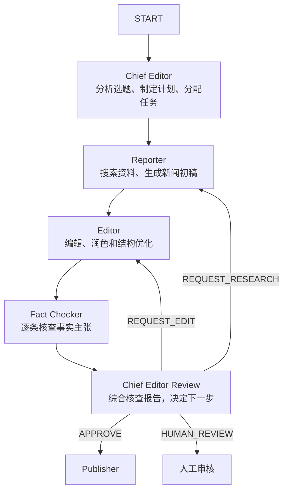

# AI Newsroom 智能新闻编辑部 — 开发实施计划（Development Plan）

| 项目 | 内容 |
| --- | --- |
| 文档编号 | NR-PLAN-001 |
| 文档版本 | V0.4 |
| 计划周期 | 6 周（可按实际时间压缩，但不压缩核心工作流测试） |
| 日期 | 2026-11-14 |
| 状态 | 基线文档 |
| 关联文档 | [PRD](../01-requirements/PRD.md)、[系统架构](../02-architecture/system-architecture.md)、[工作流设计](../04-workflow/workflow-design.md)、[状态设计](../05-data-design/state-schema.md)、[Agent 设计](../03-agent-design/agent-specification.md) |

> **总体策略**：先跑通核心业务闭环，再完善系统工程能力，最后开发前端和整理文档。
> 不在一开始同时开发五个 Agent，也不先投入大量时间做前端。

---

## 1. 制定原则

1. **核心闭环优先**：先让「选题 → 研究 → 写作 → 编辑 → 核查 → 主编决策 → 发布确认」完整跑通，再补齐工程能力。
2. **逐个验证 Agent**：每个 Agent 先独立运行、独立测试，再接入统一工作流，避免问题难以定位。
3. **流程控制归 LangGraph**：节点顺序、条件路由、循环上限由工作流负责，不把流程控制完全交给大模型。
4. **事实与发布可靠**：事实核查报告必须绑定具体文章版本；主编 `APPROVE` 不等于正式发布，必须经过用户确认。
5. **职责边界优先于 Agent 数量**：不为每个小功能单独设计 Agent。项目价值在于 Agent 之间的职责边界、协作机制和决策逻辑。
6. **每阶段都有可运行成果**：每个阶段结束时必须能演示或验证，不做无法验收的「半成品阶段」。

### 1.1 项目真正的技术难点

- 多个 Agent 如何协作；
- 如何通过 `NewsTaskState` 共享状态；
- 如何根据审核结果进行动态流转与循环修改；
- 如何保证事实核查与发布流程可靠、可追溯、可恢复。

---

## 2. 总体开发路线

| 阶段 | 内容 | 定位 | 阶段成果 |
| --- | --- | --- | --- |
| 阶段 1 | 项目基础设施搭建 | 基础准备 | 统一技术环境、项目结构、配置管理、数据库和模型接口 |
| 阶段 2 | 核心 Agent 独立开发 | 单体能力 | 记者、编辑、事实核查 Agent 可独立运行并验证输入输出 |
| 阶段 3 | LangGraph 工作流编排 | **核心里程碑** | 接入主编 Agent，完成任务规划、分配、条件路由和循环修改 |
| 阶段 4 | 数据库与任务管理 | 工程化 | 任务持久化、文章版本、执行日志、核查报告和断点恢复 |
| 阶段 5 | 发布机制与人机交互 | 业务闭环 | 主编审核、用户确认、待发布和发布记录 |
| 阶段 6 | 前端与系统集成 | 可用性 | 任务创建、执行进度、文章预览、审核结果展示 |
| 阶段 7 | 测试、优化与项目交付 | 验收交付 | 异常路径测试、Prompt 优化、部署说明和课程设计材料 |

阶段与周次的对应关系：阶段 1 → 第 1 周；阶段 2 → 第 2 周；阶段 3 → 第 3 周；阶段 4 → 第 4 周；阶段 5、6 → 第 5 周；阶段 7 → 第 6 周。

---

## 3. 六周迭代计划

| 周次 | 开发重点 | 具体工作 | 阶段成果 |
| --- | --- | --- | --- |
| 第 1 周 | 基础设施 | 搭建 Python 项目、配置 LLM API、搭建 FastAPI、设计数据库、定义 State | 项目可以启动，模型接口可调用 |
| 第 2 周 | Agent 开发 | 分别实现 Reporter、Editor、Fact Checker，设计 Prompt 和结构化输出 | 三个 Agent 可以独立运行 |
| 第 3 周 | 主编与工作流 | 实现 Chief Editor，使用 LangGraph 连接 Agent，实现条件路由和循环 | 完成核心新闻生产工作流 |
| 第 4 周 | 数据持久化 | 实现任务管理、文章版本、核查报告、执行日志、Checkpointer | 任务可保存、查询和恢复 |
| 第 5 周 | 前端与发布 | 实现 Vue 页面、任务创建、进度展示、文章预览、审核和用户确认 | 前后端完整联调 |
| 第 6 周 | 测试与交付 | 功能测试、异常测试、Prompt 优化、部署、论文和演示材料 | 形成完整可演示项目 |

---

## 4. 分阶段实施要求与验收标准

### 4.1 第 1 周：项目骨架与统一契约

不要急着开发 Agent，先把后续协作的基础定义好。

**重点任务**

1. 创建项目目录和 Git 仓库，建立提交规范。
2. 搭建 FastAPI 服务，提供健康检查接口。
3. 配置 LLM API 与搜索 API，完成最小调用验证。
4. 设计 MySQL 数据表（可先落 SQL 脚本或 ORM 模型）。
5. 定义统一的 `NewsTaskState`。
6. 约定各 Agent 的输入输出数据结构与接口契约。

**建议项目结构**

```
AI-Newsroom/
├── backend/
│   ├── agents/
│   │   ├── chief_editor.py
│   │   ├── reporter.py
│   │   ├── editor.py
│   │   ├── fact_checker.py
│   │   └── publisher.py
│   ├── graph/
│   │   ├── state.py
│   │   ├── nodes.py
│   │   ├── routing.py
│   │   └── workflow.py
│   ├── services/
│   ├── models/
│   ├── api/
│   └── main.py
├── frontend/
├── docs/
└── README.md
```

**验收标准**：能够启动后端、成功调用模型，并创建一个新闻任务、生成对应的 State 数据。

**本阶段先完成三个基础设计（后续代码不反复推翻的前提）**

1. **统一 State**：明确五个 Agent 共享哪些数据、哪些数据由谁更新。
2. **统一接口契约**：定义每个 Agent 接收什么、输出什么。
3. **统一工作流规则**：明确节点执行顺序、条件路由、循环上限和异常处理。

### 4.2 第 2 周：逐个实现 Agent

按依赖关系实现，不五个 Agent 一起开发。

| 开发顺序 | Agent | 核心任务 | 验收结果 |
| --- | --- | --- | --- |
| 1 | Reporter | 搜索资料、整理来源、生成初稿 | 输出带来源的新闻初稿 |
| 2 | Editor | 优化标题、结构、语言 | 输出编辑后的稿件 |
| 3 | Fact Checker | 提取事实主张、逐条查证 | 输出事实核查报告 |
| 4 | Chief Editor | 规划、分配、审核、决策 | 输出结构化决策 |
| 5 | Publisher | 创建待发布记录、执行发布 | 等待用户确认后发布 |

**安排理由**：Reporter、Editor、Fact Checker 构成新闻生产的核心链条。先确保这条链条能独立运行，再把主编加入统一调度，更容易定位问题。

**验收要求**：每个 Agent 必须有独立的输入、输出和测试用例，不能只验证「能否返回一段自然语言」，而要验证结构化字段、来源信息和异常分支。

### 4.3 第 3 周：LangGraph 工作流编排（核心里程碑）

本阶段最值得投入精力。需要实现以下流程：



**本周至少完成**

- LangGraph State 定义；
- Agent 节点注册；
- 节点之间的数据传递；
- 条件边和循环路由；
- 最大重试次数和异常处理；
- 工作流执行日志。

**验收标准**：输入一个新闻选题，系统可以自动完成选题规划、资料搜索、稿件生成、编辑、事实核查和主编审核，并根据主编决策进入不同分支。

### 4.4 第 4 周：数据库与任务管理

目标是让系统从「一次性运行的 Agent Demo」变成「可以持续使用的应用」。

**必须完成**

- 新闻任务创建、查询和状态更新；
- 文章版本管理；
- 事实核查报告持久化；
- Agent 执行日志；
- LangGraph Checkpointer；
- 工作流中断与恢复。

**关键约束**：事实核查报告必须关联具体的文章版本。文章修改后，不得继续沿用旧版本的核查结果。

### 4.5 第 5 周：前端与发布机制

前端先保证核心页面可用，不追求复杂交互。

| 页面 | 功能 |
| --- | --- |
| 任务管理 | 创建任务、查看任务状态 |
| 工作流监控 | 查看 Agent 执行进度 |
| 稿件管理 | 预览文章、查看不同版本 |
| 审核中心 | 核查报告、审核结果、发布确认 |

**发布流程必须明确区分以下步骤**：

1. 主编审核通过；
2. Publisher 创建待发布记录；
3. 用户确认发布；
4. 系统调用发布接口；
5. 保存发布结果。

**红线**：不能因为主编 `APPROVE` 就直接发布。

### 4.6 第 6 周：测试、优化与交付

**至少覆盖的测试场景**

| 测试场景 | 预期结果 |
| --- | --- |
| 正常新闻任务 | 完成完整工作流 |
| 事实核查未通过 | 返回主编重新决策 |
| 编辑质量不合格 | 返回 Editor 修改 |
| 资料不足 | 返回 Reporter 补充研究 |
| Agent 调用失败 | 重试或记录失败 |
| 用户暂缓发布 | 保留待发布状态 |
| 工作流中断 | 能够恢复执行 |

**最终交付物**

- 项目部署文档；
- 系统架构图；
- Agent 职责说明；
- 工作流设计图；
- 测试报告；
- 项目演示视频或 PPT。

---

## 5. 开发优先级

| 优先级 | 功能 | 建议 |
| --- | --- | --- |
| P0：必须完成 | 五个 Agent、LangGraph 编排、条件路由、核心 State | 第一目标 |
| P0：必须完成 | 新闻任务管理、稿件版本、事实核查、人工确认发布 | 保证业务闭环 |
| P1：尽量完成 | Checkpointer、执行日志、异常重试、前端监控 | 提高工程完整度 |
| P2：时间允许 | 多模型协作、Agent 动态选择、复杂权限、实时协同编辑 | 后续扩展 |

**裁剪原则**：如果实际开发时间短于 6 周，优先压缩前端和 P2 高级功能，不压缩核心工作流与其测试。

---

## 6. 开发节奏与提交规范

每个功能都遵循以下循环：

1. **先设计**：确定功能、输入输出和状态变化。
2. **再编码**：实现一个最小可运行版本。
3. **单独测试**：使用固定输入验证结果。
4. **集成测试**：接入其他 Agent 或服务。
5. **更新文档**：同步修改设计文档和接口约定。

### 6.1 Git 提交要求

- 初始化仓库后保持小步提交，每个可运行增量单独提交；
- 提交信息使用 `type(scope): summary` 格式，例如：
  - `feat(graph): add conditional routing for chief review`
  - `feat(agent): implement reporter with source tracking`
  - `fix(state): bind fact-check report to article version`
  - `docs(plan): add six-week development roadmap`
- 禁止提交 `.env`、密钥、数据库密码和本地虚拟环境；
- 每个阶段结束打一个可回溯的提交或标签。

### 6.2 阶段完成定义（Definition of Done）

- 代码可运行，且通过对应单元测试；
- 核心路径有日志或可观测输出；
- 数据结构与设计文档一致；
- 相关文档已同步更新；
- 变更已提交到 Git。

---

## 7. 风险与应对

| 风险 | 应对 |
| --- | --- |
| 五个 Agent 并行开发导致问题难定位 | 按 Reporter → Editor → Fact Checker → Chief → Publisher 顺序推进 |
| 过早投入前端导致核心流程不稳定 | 前 4 周只保留最小联调接口，第 5 周集中开发页面 |
| 流程控制被大模型「自由发挥」 | 路由、循环上限、异常处理全部由 LangGraph 控制 |
| 稿件修改后沿用旧核查结果 | 核查报告强制绑定文章版本 ID |
| 主编通过即被误发布 | 发布必须经过独立的用户确认节点 |
| 任务中断后无法恢复 | 第 4 周引入 Checkpointer 并做中断恢复测试 |
| 项目范围持续膨胀 | 按 P0/P1/P2 管理范围，阶段验收不过不进入下一阶段 |

---

## 8. 每周复盘机制

每周结束时复盘以下内容，并据此制定下一周任务：

- 本周完成了哪些模块，是否达到验收标准；
- 哪些设计在实际编码中被证明不合理，需要回写文档；
- 当前最大风险是什么，下周如何消除；
- 是否存在范围蔓延，是否需要降级为 P1/P2；
- 下一周的可演示成果是什么。

---

## 9. 下一步（立即执行）

正式进入第 1 周，完成以下三项后再开始写 Agent 代码：

1. 定义并评审 `NewsTaskState`；
2. 定义并评审 Agent 接口契约（输入、输出、结构化字段）；
3. 定义并评审工作流规则（节点顺序、条件路由、循环上限、异常处理）。

这三项确定后，再搭建 FastAPI 骨架、数据库模型和最小模型调用链路。

---

## 10. 第 1 周执行记录（2026-11-13）

**已完成**

- `NewsTaskState` 及嵌套领域模型（Pydantic，含枚举与不变量校验）；
- 五个 Agent 的输入 / 输出契约（主编拆分为规划、审核两个节点）及契约注册表；
- FastAPI 骨架：统一响应、请求 ID、异常处理、CORS；
- 任务创建 / 列表 / 详情 / 取消接口（内存存储）；
- 42 个单元与接口测试全部通过（含配置测试）；
- 已通过 uvicorn 启动并实际请求 `/api/news/health` 验证服务可运行；
- LLM 实际调用冒烟通过：DeepSeek `deepseek-chat`，HTTP 200，返回 `OK`，耗时约 1.2 秒；
- State、Agent、API 设计文档同步至 V0.2。

**待验证 / 后续**

- 搜索 API Key 尚未配置（健康检查 `search_configured=false`），在第二周实现 Reporter 前补齐（已于 2026-11-14 补齐）；
- MySQL 表结构落地与持久化安排在第四周，本周任务存储为进程内存实现；
- Agent 业务逻辑从第二周开始实现。

---

## 11. 第 2 周执行记录（2026-11-13）

**已完成**

- Reporter Agent：两阶段执行（检索词生成 → 搜索 → 初稿撰写）；来源按 URL 去重并由代码编号；支持 `revision_request` 补充资料、复用已有来源和上一版初稿。
- Editor Agent：结构化编辑并输出编辑说明；新版本号由代码 `current_version + 1` 生成，不采信模型返回的版本；拒绝处理 `target=reporter` 的退回要求。
- Fact Checker Agent：断言抽取 → 逐条搜索 → 依据证据判定；模型只返回证据编号，URL 与证据摘录由代码绑定；`overall_result` 与 `recommendation` 由代码根据断言结果计算；未知来源编号会被忽略并降级为 `UNVERIFIED`。
- LLM 客户端：OpenAI 兼容 Chat Completions，JSON mode，支持超时 / 429 / 5xx 有限重试；错误分类为 `LLM_NOT_CONFIGURED`、`LLM_REQUEST_FAILED`、`LLM_INVALID_JSON`、`LLM_OUTPUT_INVALID`。
- 搜索工具：Tavily Search API 封装，负责 URL 过滤、摘要截断与错误分类。
- Prompt 管理：YAML + Jinja2，共享输出 / 安全 / 来源规则；检索结果与稿件正文以 `untrusted_content` 隔离。
- 测试：全量 `80 passed`，覆盖成功路径、来源去重、版本递增、证据绑定、无效输出重试、搜索失败与配置缺失等分支。
- 真实模型冒烟：Editor 使用 DeepSeek 返回 `COMPLETED`（version=2）；Reporter → Editor → Fact Checker 全链路 `COMPLETED`，核查结果 `PASSED`（3 条断言）。链路冒烟中的搜索结果为本地测试桩，仅用于验证结构，不代表真实检索。

**待验证 / 后续**

- ~~`SEARCH_API_KEY` 仍未配置~~ → 已于 2026-11-14 配置并完成真实联网验证，见下方更新记录；
- 主编 Agent、Publisher、LangGraph 编排与条件路由安排在第 3 周；
- Agent 尚未通过 API 暴露执行接口，第 3 周随工作流一并接入。

**2026-11-14 更新：真实联网链路验证**

- Tavily 密钥配置完成（首轮用的 UUID 值被服务端判定 401，已替换为 `tvly-` 开头的正式密钥）；单次真实检索返回 3 条结果。
- Reporter → Editor → Fact Checker 全链路使用真实 DeepSeek + 真实 Tavily 运行，三个 Agent 均 `COMPLETED`：
  - Reporter 产出 12 条来源（`SRC_0001` ~ `SRC_0012`）、1080 字初稿、4 条未核实信息；
  - Editor 产出版本 `2`；
  - Fact Checker 报告绑定版本 `2`，8 条断言全部 `VERIFIED`，`PASSED` / `APPROVE`。
- 该冒烟只验证链路与结构化输出，核查准确率仍需按测试计划第 8 节评测集评估。

---

## 12. 第 3 周执行记录（2026-11-14）

**已完成**

- 主编 Agent（拆分为两个节点）：
  - `chief_planning`：输出 `topic_analysis`、`reporting_angles`、`research_tasks`、`article_outline`、`verification_points`；
  - `chief_review`：输出四种决策与结构化退回要求；`APPROVE` 仅在核查 `PASSED` 时保留；退回次数达到上限强制转人工。
- Publisher Agent：校验 `APPROVE` 与核查状态；未确认时创建待发布记录；确认后调用按 `(article_id, version)` 幂等的模拟发布通道；通道失败保持 `PENDING_PUBLISH` 并允许重试。
- LangGraph 编排：九个节点（`chief_planning`、`reporter`、`editor`、`fact_checker`、`chief_review`、`human_approval`、`publisher`、`user_confirmation`、`publish`）、条件路由、退回循环、`interrupt()` 人工审核与发布确认、`MemorySaver` 检查点、执行日志、失败即终止。
- 测试：全量 `120 passed`，新增 40 项覆盖主编、Publisher、路由与工作流分支。
- 真实冒烟：DeepSeek + Tavily 完整工作流从规划到 `PUBLISHED`（模拟发布地址）一次跑通。

**实现说明**

- 发布确认拆成独立节点，恢复时不会重复创建待发布记录；
- `ChiefReviewInput` 增加 `requirements`，审核可对照用户风格与篇幅要求；
- 待发布记录与正式发布均使用模拟通道，真实发布接口在第 5 周接入。

**待验证 / 后续**

- MySQL 持久化、持久化 Checkpointer 与进程重启恢复（第 4 周）；
- 工作流执行 API（创建任务后触发、人工审核恢复、发布确认恢复）与并发控制（第 4 ~ 5 周）；
- 前端页面与真实发布通道（第 5 周）。

---

## 13. C-01 数据库基础落地（2026-11-22）

**已完成**

- 新增 SQLAlchemy 异步数据库层：`app/db/base.py`、`app/db/session.py`、`app/db/task_store.py`；
- 新增任务表与执行事件表模型：`tasks`、`execution_events`；任务状态与当前阶段分别存列，完整状态快照存 `state_json`；
- 任务存储支持内存与数据库两种实现，API 默认走数据库；测试默认使用内存存储，另加临时 SQLite 数据库测试；
- 执行事件按 `task_id + seq` 顺序落库，任务更新时从 `execution_logs` 增量同步；
- 增加任务级执行锁 `try_acquire_lock / release_lock`，为 C-06 防重复启动预留；
- 配置增加 `database_echo`、`max_interface_retries`；本地默认数据库改为 `sqlite+aiosqlite:///./newsroom.db`，MySQL 仍可通过 `DATABASE_URL` 切换；
- `requirements.txt` 增加 `sqlalchemy[asyncio]` 与 `aiosqlite`；
- 新增 `tests/test_db_store.py`，覆盖任务持久化、事件顺序、执行锁、API 落库与重启后查询。

**验证结果**

- 全量测试 `134 passed`；
- 同一 SQLite 文件关闭应用后重新启动，任务仍可查询；
- 同一任务第二次获取执行锁失败，释放后可再次获取。

**当前边界**

- 本轮只落 C 的任务与执行事件，没有改任务状态枚举和工作流末段；
- 稿件版本、来源/核查/专项检查报告仍由 B、D 各自建表；
- 下一阶段：按分工文档将任务状态改为“运行、待人工处理、待复核、已交付、失败、终止”，并把发布链换成专项检查、主编决策与预发布准备链。

## 14. C 状态机与交付链改造（2026-11-22）

**背景**

按分工文档与课程业务口径，系统不对外发布新闻：主编审核通过后只需准备交付材料，由用户复核、导出并自行投稿。第 3 周的发布链（Publisher → 发布确认）与此不符，需要改为「专项检查 → 主编决策 → 预发布准备 → 待复核 → 已交付」。

**已完成**

- 任务状态改为六个业务状态：`RUNNING`（运行）、`HUMAN_REVIEW`（待人工处理）、`PENDING_REVIEW`（待复核）、`DELIVERED`（已交付）、`FAILED`（失败）、`TERMINATED`（终止）；执行阶段由 `WorkflowStage` 单独记录，不再混入业务状态；
- 工作流新增两个节点（当前为确定性占位，D 模块后续替换）：
  - `special_check`：事实核查之后执行，报告绑定 `task_id + article_id + article_version`，结论 `PASSED / WARNING / BLOCKED`；
  - `prepare_delivery`：主编 `APPROVE` 后执行，校验前置条件并生成 `DeliveryPackage`，任务进入 `PENDING_REVIEW`；
- 主编审核新增硬约束：事实核查非 `PASSED` 或专项检查 `BLOCKED` 时 `APPROVE` 降级为 `HUMAN_REVIEW`；`WARNING` 保留 `APPROVE` 但注明提示项；`revision_round` 达到 `max_revision_rounds` 强制转人工；
- 人工审核不能覆盖 `FAILED` / `BLOCKED` 结论：此时批准无效，任务保持 `HUMAN_REVIEW`；人工仍可终止任务或退回修改；
- 修改轮次 `revision_round` 与接口失败重试 `interface_retry_counts` 分离，前者只统计稿件退回次数；
- 取消任务与人工终止统一落到 `TERMINATED`；已交付或已终止任务不可再取消（409）；
- 交付确认：`PENDING_REVIEW` 下确认交付置为 `DELIVERED`，暂不交付保持 `PENDING_REVIEW`；非待复核状态调用交付接口返回 409；
- 演示控制台同步新阶段（专项检查、主编审核、待复核、已交付）、修改轮次与交付卡片；
- `publisher` / `publish_service` 退出工作流，代码与契约保留为 B/D 交接桩。

**文档同步**

- `docs/04-workflow/workflow-design.md`：节点、路由、状态迁移与当前图代码（V0.3）；
- `docs/05-data-design/state-schema.md`：字段、领域模型与不变式（V0.3）；
- `docs/06-api/api-specification.md`：状态口径、交付接口、演示接口与实现状态；
- `docs/03-agent-design/agent-specification.md`：Agent 关系、审核决策与节点契约（V0.4）；
- `docs/07-prompts/prompt-design.md`：主编审核 Prompt 新增专项检查与修改轮次变量，交付链无 Prompt。

**验证结果**

- 后端全量测试 `140 passed`；
- 覆盖：状态不变式、路由、正常工作流（到 `PENDING_REVIEW` 并生成交付包）、专项检查阻断、人工批准/阻断覆盖/终止、修改轮次上限、演示接口交付确认与幂等冲突。

**当前边界与后续**

- C-05 执行服务与接口（execute / pause / resume / decision / events）尚未开始，演示接口暂作为联调入口；
- C-04 接口失败重试计数与展示待接入执行服务；
- C-06 重启恢复、重复启动防护（执行锁已就绪）与手工编辑后的版本失效待实现；
- 专项检查与预发布准备当前为占位实现，待 D 模块交付真实逻辑后替换，契约保持不变。

## 15. C-05 执行服务与接口（2026-11-22）

**已完成**

- 新增 `ExecutionService`（`backend/app/services/execution_service.py`），负责正式任务的执行编排：
  - `execute`：仅 `CREATED` 且未暂停的任务，校验通过后返回 `202` 并启动后台 `asyncio.Task`，把图运行到下一个暂停点（人工审核 / 待复核 / 失败 / 终止）；
  - 后台作业每个状态分块落库（指纹变化才写），运行异常统一落 `FAILED` + `RUNTIME_ERROR`，并释放执行锁；
  - `pause` / `resume`：暂停标记在节点边界生效，任务停止时保存为 `RUNNING + paused`；`resume` 从检查点续跑（`payload=None`），暂停尚未生效时返回 `2003`；
  - `submit_human_review`：校验任务状态与待处理中断后，以 `Command(resume=payload)` 启动后台续跑，支持批准、退回修改、终止；
  - `confirm_delivery`：`PENDING_REVIEW` 下确认交付置为 `DELIVERED`，拒绝时保持待复核；
  - `list_events`：按序返回 Agent 执行事件。
- 正式接口接入 `/api/news/tasks`：
  - `POST /{task_id}/execute`、`/pause`、`/resume`（execute / resume 返回 `202`）；
  - `POST /{task_id}/human-review`（批准 / 退回 / 终止，返回 `202` 与最新 `TaskDetail`）；
  - `GET /{task_id}/delivery`、`POST /{task_id}/delivery/confirm`；
  - `GET /{task_id}/events`。
- 写接口返回最新 `TaskDetail`，前端通过轮询 `GET /tasks/{id}` 获取后台推进结果。
- 执行期间使用任务级执行锁（`execution_lock_ttl_seconds`，默认 900 秒）；并发启动返回业务码 `2003`；人工决策 / 恢复先等待收尾中的作业退出（最多 5 秒）。
- 工作流新增 `stream` / `stream_continue` / `has_next_step`，支持按分块消费并在检查点续跑。
- 执行期间使用任务级执行锁（`execution_lock_ttl_seconds`，默认 900 秒）；并发执行返回业务码 `2003`。
- 运行时异常会落库为 `FAILED` + `RUNTIME_ERROR`，不会让任务停留在不可解释状态。
- `create_app` 支持注入自定义工作流，便于测试与后续替换 Agent。
- 恢复人工审核前通过 `NewsroomWorkflow.has_pending_interrupt` 校验待处理中断，避免对已结束的图重复恢复。

**验证结果**

- 全量测试 `165 passed`；
- 新增 `tests/test_execution_service.py`、`tests/test_api_execution.py`，覆盖后台执行完成、重复启动、并发 `2003`、暂停 / 恢复（含暂停未生效重试）、执行锁冲突、人工批准 / 退回 / 终止、交付确认（确认与拒绝）、事件查询、参数校验、404 与运行时异常落库。

**当前边界**

- 后台作业为单进程内 `asyncio.Task`，多副本部署需要改为外部任务队列（课程范围不涉及）；
- 执行锁只防并发，不处理进程崩溃后的锁残留（TTL 到期释放）与重启恢复，C-06 继续；
- 人工审核恢复依赖进程内 `MemorySaver` 检查点，服务重启后无法恢复（C-06）；
- 演示控制台仍使用 `/api/news/demo` 接口，后续切换到 `/tasks`；
- SSE 实时进度未实现。

## 16. C-04 条件分支与接口失败重试（2026-11-22）

**已完成**

- 条件分支已由 `backend/app/graph/routing.py` 覆盖：
  - 主编 / 人工要求补充资料 → 回 `reporter`，要求修改表述 → 回 `editor`，重大争议 → `human_approval`；
  - 稿件修改轮次 `revision_round` 达到 `max_revision_rounds` 后强制转人工，与接口重试互不影响。
- 新增 `backend/app/core/retries.py`，按任务、按接口（`llm` / `search`）累计失败重试：
  - 节点执行期间通过 `ContextVar` 绑定 `InterfaceRetryTracker`，预算为 `Settings.max_interface_retries`（默认 2）；
  - 节点包装器 `_tracked_node` 在每个节点执行后将新增计数合并进 `interface_retry_counts`，随检查点持久化。
- LLM 客户端与搜索工具接入重试预算：
  - 单次调用对可重试错误最多尝试 2 次；
  - 预算耗尽且仍失败时不重试，LLM 返回 `INTERFACE_RETRY_EXCEEDED`，搜索返回不可重试的 `SEARCH_FAILED`；
  - 重试计数与修改轮次分开记录，任务详情通过 `TaskDetail.interface_retry_counts` 返回给前端。

**验证结果**

- 全量测试 `172 passed`；
- 新增 `tests/test_interface_retries.py`，并在 `test_llm_client.py`、`test_search_tool.py` 中补充重试计数、预算耗尽与计数持久化用例。

**当前边界**

- 预算为任务级静态上限，暂不支持按接口配置不同预算；
- 重试预算耗尽后任务直接 `FAILED`，不支持从失败节点原地续跑（依赖 C-06 的恢复能力）；
- `interface_retry_counts` 仅统计客户端自动重试，业务层的检索关键词更换不计入该字段。
